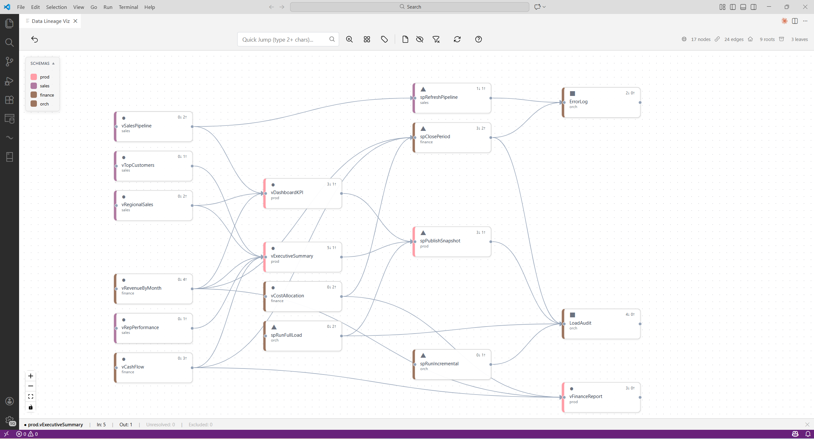

# Data Lineage Viz

[](LICENSE)
[](https://marketplace.visualstudio.com/items?itemName=datahelper-chwagner.data-lineage-viz)


See SQL dependencies as a graph inside VS Code. Search, trace and filter it, and optionally ask `@lineage` about it in plain language.

Load a `.dacpac` file or connect to SQL Server, Azure SQL, Fabric Data Warehouse or Synapse Dedicated SQL Pool.

[](https://www.youtube.com/watch?v=2Ybg2daCrB0)

▶ **[Watch the demo](https://www.youtube.com/watch?v=2Ybg2daCrB0)**

## Requirements

- [VS Code](https://code.visualstudio.com/) 1.101 or later.
- A `.dacpac` file, or a database login with `VIEW DEFINITION` (plus `SELECT` on tables you want to profile). See [Database projects](#database-projects).
- Optional, for `@lineage` only: a VS Code Language Model Chat provider such as [GitHub Copilot](https://marketplace.visualstudio.com/items?itemName=GitHub.copilot) or a compatible BYOK provider.

## Get started

Install [Data Lineage Viz from the Visual Studio Marketplace](https://marketplace.visualstudio.com/items?itemName=datahelper-chwagner.data-lineage-viz), then:

1. Run **Data Lineage: Open Wizard** (`Ctrl+Shift+P`).
2. Click **+ Create New Project**, then **Open .dacpac file…** or **Connect to database…** (see [Database projects](#database-projects)).
3. Select schemas and click **Visualize**.

No data? Click **Try with demo data** or run **Data Lineage: Open Demo** to explore the AdventureWorks sample.

## Database projects

Connect with SQL login or Microsoft Entra ID. Save and manage connections in the wizard; passwords stay in VS Code secret storage. Use a read-only login. The catalog queries are in [`docs/DMV_QUERIES.md`](docs/DMV_QUERIES.md); for connection help, see [Troubleshooting](docs/TROUBLESHOOTING.md#import-and-connection).

## Explore your lineage

The graph works without any AI provider:

- Search objects, or search inside SQL bodies.
- Trace upstream sources or downstream consumers, or find the shortest path between two objects.
- Find hubs, islands, orphans, cycles and long chains.
- Open an object's DDL or columns.
- Large graphs open in Schema View; double-click a schema to drill in.
- Profile table columns in live databases (nulls, distinct, min/max, AVG, STDEV).
- Save projects and bookmarks, and export to Draw.io.

External tables and external references (OPENROWSET, cross-database, CETAS) appear as nodes.



## Optional AI lineage with `@lineage`

With a VS Code Language Model Chat provider, `@lineage` answers questions about the loaded model, using the model you picked in chat.

```text
@lineage trace from Sales.SalesOrderDetail upstream to the source tables
@lineage how is sales calculated — show me the lineage in the app
@lineage which objects are hubs with the most connections?
```


It answers in chat, draws a **graph preview** you can save as a bookmark, or, with `/trace`, walks the graph hop by hop after you approve the plan. See [`docs/FEATURES.md`](docs/FEATURES.md#lineage-ai).

## Security and privacy

- No telemetry. `.dacpac` parsing is offline. The only network connections are your database, Entra ID sign-in and, for `@lineage`, your chosen language model.
- Live imports and profiling run read-only queries only when you start them.
- `@lineage` sends your prompt, its chat history and the returned metadata or DDL to the selected model. It cannot connect to a database or run SQL.
- Custom YAML files are trusted; custom DMV SQL runs as written.

Details: [`SECURITY.md`](SECURITY.md).

## Limitations

The graph comes from database metadata only. Not covered:

- **External pipelines** (ADF, SSIS, Spark, Dataflow): their target tables appear as leaves.
- **Other databases or servers**: shown as external nodes, not explored.
- **Dynamic SQL** (`EXEC(@sql)`, `sp_executesql`).
- **References without a schema**: may not resolve.
- **Triggers, synonyms, CLR modules, sequences and user-defined types**: not loaded, and references through them are lost.
- **Encrypted or unviewable procedures**: shown without dependencies, with a warning.

Synapse serverless SQL pool is not supported. Parse details: [`docs/PARSE_RULES.md`](docs/PARSE_RULES.md).

## FAQ

**Do I need a `.dacpac` file?** No, you can connect to a database. To make one, use Visual Studio, SSMS, Azure Data Studio or the Fabric portal ([how](https://learn.microsoft.com/sql/relational-databases/data-tier-applications/data-tier-applications)).

**Why are some dependencies missing?** See [Limitations](#limitations) and [Troubleshooting](docs/TROUBLESHOOTING.md).

## Documentation

- [`docs/FEATURES.md`](docs/FEATURES.md): features and settings.
- [`docs/TROUBLESHOOTING.md`](docs/TROUBLESHOOTING.md): common issues.
- [`docs/DMV_QUERIES.md`](docs/DMV_QUERIES.md): import queries, for DBA review.
- [`docs/PROFILING_PATTERNS.md`](docs/PROFILING_PATTERNS.md): profiling SQL.
- [`docs/PARSE_RULES.md`](docs/PARSE_RULES.md) and [`docs/AI_PROMPTS.md`](docs/AI_PROMPTS.md): customization YAML.
- [`CHANGELOG.md`](CHANGELOG.md): release history.
- [`docs/DEVELOPER_GUIDE.md`](docs/DEVELOPER_GUIDE.md): build from source and code layout.

## Source code

The source is public so you can clone, build and adapt it under the MIT license; see [`CONTRIBUTING.md`](CONTRIBUTING.md). Report bugs in [issues](https://github.com/ChrisDevRepo/vscode_data_lineage/issues) and vulnerabilities as described in [`SECURITY.md`](SECURITY.md).

## License

[MIT](LICENSE). Third-party licenses are listed in [`THIRD_PARTY_NOTICES.md`](THIRD_PARTY_NOTICES.md).

---

[Christian Wagner](https://www.linkedin.com/in/christian-wagner-11aa8614b) · [GitHub](https://github.com/ChrisDevRepo/vscode_data_lineage)
