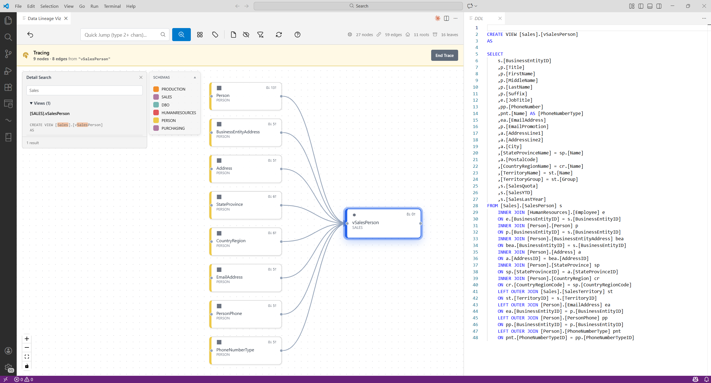
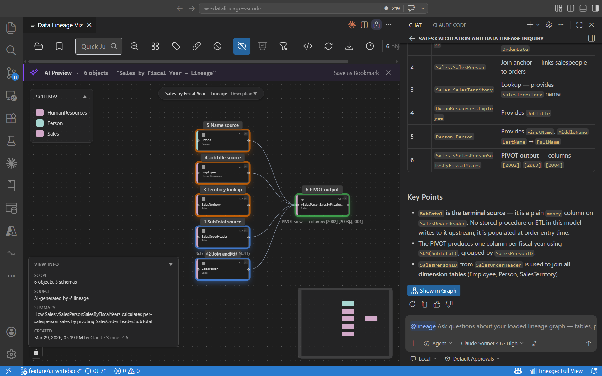

# Data Lineage Viz

[](LICENSE)
[](https://marketplace.visualstudio.com/items?itemName=datahelper-chwagner.data-lineage-viz)


A free, open-source VS Code helper for DBAs, data engineers and others working with SQL databases. Explore **object-level lineage** between tables, views, procedures and functions: search dependencies, trace connections and read SQL definitions.

The graph works without AI. The optional `@lineage` chat participant can explain SQL and investigate lineage based on your questions, including column relationships to check against the SQL.

Load a `.dacpac` file or connect to SQL Server, Azure SQL, Fabric Data Warehouse or Synapse Dedicated SQL Pool.

[](https://www.youtube.com/watch?v=2Ybg2daCrB0)

▶ **[Watch the demo](https://www.youtube.com/watch?v=2Ybg2daCrB0)**

## Requirements

- [VS Code](https://code.visualstudio.com/) 1.101 or later.
- A `.dacpac` file, or a database login with `VIEW DEFINITION` (plus `SELECT` on tables you want to profile). See [Database projects](#database-projects).
- Optional, for `@lineage` only: a VS Code Language Model Chat provider such as [GitHub Copilot](https://marketplace.visualstudio.com/items?itemName=GitHub.copilot) or a compatible BYOK provider.

Once installed, loading a local `.dacpac`, exploring its graph, viewing SQL, saving bookmarks and exporting work offline. No database connection or chat provider is required. Live imports and profiling need database access; hosted chat models need their provider connection.

## Get started

Install [Data Lineage Viz from the Visual Studio Marketplace](https://marketplace.visualstudio.com/items?itemName=datahelper-chwagner.data-lineage-viz), then:

1. Run **Data Lineage: Open Wizard** (`Ctrl+Shift+P`).
2. Click **+ Create New Project**, then **Open .dacpac file…** or **Connect to database…** (see [Database projects](#database-projects)).
3. Select schemas and click **Visualize**.

No data? Click **Try with demo data** or run **Data Lineage: Open Demo** to explore the AdventureWorks sample.

## Database projects

The extension supports **SQL login** and **Microsoft Entra ID**. Windows authentication is not supported.

Save, reuse and manage connections in the wizard or with **Add / Edit / Remove Database Connection** and **Update Database Password**. Passwords stay in VS Code secret storage.

A live project reads database metadata for lineage and, only when you ask, profiles table data. Use a least-privilege login with the permissions needed for those operations. The catalog queries are in [`docs/DMV_QUERIES.md`](docs/DMV_QUERIES.md) and the profiling SQL in [`docs/PROFILING_PATTERNS.md`](docs/PROFILING_PATTERNS.md). For setup, permissions and connection help, see [Troubleshooting](docs/TROUBLESHOOTING.md#import-and-connection).

## Explore your lineage

The graph works without any AI provider:

- Search objects (**Data Lineage: Search Objects** or <kbd>/</kbd>), or search inside SQL bodies.
- Trace upstream sources or downstream consumers, or find the shortest path between two objects.
- Find hubs, islands, orphans, cycles and long chains.
- Open an object's DDL, columns and constraints.
- Large graphs open in Schema View; double-click a schema to drill in.
- Profile table columns in live databases (row count, nulls, distinct, min/max, AVG, STDEV).
- Save projects and bookmarks, and export to Draw.io.

`.dacpac` files (SSDT and SDK-style) and live databases are supported. External tables and external references (OPENROWSET, cross-database, CETAS) appear as nodes.

The full feature catalogue is in [`docs/FEATURES.md`](docs/FEATURES.md).

## Optional AI lineage with `@lineage`

With a VS Code Language Model Chat provider, `@lineage` answers questions about the loaded model, using the model you picked in chat. Its tools read the loaded graph, SQL definitions and saved analysis; they cannot connect to a database or run SQL.

```text
@lineage trace from Sales.SalesOrderDetail upstream to the source tables
@lineage how is sales calculated — show me the lineage in the app
@lineage which objects are hubs with the most connections?
```

Use it to ask dependency questions, preview graph scopes and save them as bookmarks, ask about what is on screen (*"explain this trace"*, or `#lineageView`), recall what an earlier analysis found from its saved AI bookmark, and explain SQL logic.



`@lineage` answers in one of three ways:

- **Chat answer** (default) — object lookups, DDL search, graph patterns, bounded upstream/downstream questions and source-to-target paths, answered in chat. `/search` always uses this mode.
- **Graph preview** — the **Show graph preview** follow-up opens a temporary preview in the graph view. Save it as a bookmark to keep it.
- **Deep analysis** — `/trace`, the **Start deeper hop-by-hop analysis** follow-up, or a question larger than the configured budget first shows the planned scope for you to approve, change or cancel. The approved scope is then walked hop by hop, and the result colours source, transform and target objects. A deep analysis follows whole objects, or, as an option, traces named columns; column mappings come from the language model, so check them against the SQL.

The graph, search, trace, SQL preview, demo data, profiling and export work without a chat provider. Details: [`docs/FEATURES.md`](docs/FEATURES.md#lineage-ai).

## Settings and customization

Run **Data Lineage: Settings** or search `dataLineageViz` in VS Code Settings. Every setting is listed in the [settings reference](docs/FEATURES.md#settings-reference). Frequently used ones:

- `dataLineageViz.maxNodes` and `dataLineageViz.renderLimit` — how many objects are loaded and drawn.
- `dataLineageViz.excludePatterns` — objects hidden on every load.
- `dataLineageViz.tableStatistics.enabled` — turns table profiling off.
- `dataLineageViz.ai.enabled` — turns `@lineage` off.

Parse rules, DMV queries and AI output templates are YAML you can override: **Data Lineage: Create Parse Rules**, **Create DMV Queries** and **Create AI Output Templates** copy the built-in file into your workspace, then set `dataLineageViz.parseRulesFile`, `dataLineageViz.dmvQueriesFile` or `dataLineageViz.ai.outputTemplateFile`. See [`docs/PARSE_RULES.md`](docs/PARSE_RULES.md), [`docs/DMV_QUERIES.md`](docs/DMV_QUERIES.md#custom-queries) and [`docs/AI_PROMPTS.md`](docs/AI_PROMPTS.md#customize-output-templates).

## Security and privacy

- **DACPAC:** parsed locally; loading it makes no database connection. If you use AI afterward, relevant definitions and metadata can be sent to the selected model.
- **Database import:** runs the built-in read-only catalog queries in [`docs/DMV_QUERIES.md`](docs/DMV_QUERIES.md) when you start an import.
- **Table statistics:** runs row-count and aggregate queries on a table when you request them (`dataLineageViz.tableStatistics.enabled`).
- **`@lineage` (optional):** sends the question, recent chat and the SQL or metadata it reads to the chat model selected in VS Code. It cannot run SQL (`dataLineageViz.ai.enabled`).
- Logs are local.

Details: [`SECURITY.md`](SECURITY.md).

## Limitations

The lineage graph is built from database DDL/catalog metadata only. The following are out of scope:

- **External ingestion pipelines** — ADF, SSIS, Spark, Fabric Dataflow, or any ETL/ELT process that writes *into* the database from an external source. Target tables appear as leaves; the upstream pipeline does not.
- **Cross-database / cross-server flow** — three- or four-part references to another database surface as virtual external nodes; the remote database internals are not introspected. A three-part name is local only when its database is the connected database, or for a DACPAC the name in its `DacMetadata.xml` (the source database for an extracted DACPAC, the project name for a built one).
- **Dynamic SQL and cursors** — `EXEC(@sql)`, `sp_executesql` and cursors are not analysed; the tables around them still load, and the output log warns how many modules use them; the debug log names them.
- **SQLCMD variables** — a DACPAC stores a database reference such as `[$(OtherDb)]` without its value, which is set at deployment. It is shown as a cross-database node named `[$(OtherDb)]`, not as the deployed database.
- **Unqualified references** — references without a schema prefix are ambiguous; metadata may resolve some known dependencies, but dynamic/default-schema cases are not guaranteed.
- **Triggers, synonyms and other object kinds** — only tables, views, functions, stored procedures and external objects are loaded. Triggers, synonyms, CLR modules, extended stored procedures, sequences and user-defined types are not: they do not appear as nodes, and references made through them do not become edges.
- **Features that are not database objects** — built-in and function-style features (JSON, XML, vector, `PREDICT`, SQL Graph syntax), types, column methods and variables are ignored. The tables around them are read as usual.
- **Unreadable definitions** — a stored procedure created `WITH ENCRYPTION`, or one whose definition the connected user may not view, is shown as a node without dependencies and marked with a warning; its body cannot be read.
- **Deterministic column-level lineage** — the parser builds object dependencies, not column-to-column lineage. Optional `@lineage` investigations can trace columns requested in your question; check their conclusions against the SQL.

Supported platforms are SQL Server, Azure SQL, Fabric Data Warehouse and Synapse Dedicated SQL Pool. Synapse serverless SQL pool is not supported. The parse details are in [`docs/PARSE_RULES.md`](docs/PARSE_RULES.md).

## FAQ

**Do I need a `.dacpac` file?**
No, you can connect to a database. To make one, extract it with Visual Studio, SSMS, Azure Data Studio or the Fabric portal ([how](https://learn.microsoft.com/sql/relational-databases/data-tier-applications/data-tier-applications)).

**Why are some dependencies missing?**
Only dependencies visible in compiled metadata or parseable SQL bodies are detected; dynamic SQL cannot be analysed statically. See [Limitations](#limitations) and [Troubleshooting](docs/TROUBLESHOOTING.md).

**Why are unqualified references unreliable?**
An unqualified name depends on the caller's default schema and context. Schema-qualified names are the only reliable source for static lineage.

## Documentation

- [`docs/FEATURES.md`](docs/FEATURES.md): full feature catalogue and settings.
- [`docs/TROUBLESHOOTING.md`](docs/TROUBLESHOOTING.md): common issues.
- [`docs/DMV_QUERIES.md`](docs/DMV_QUERIES.md): live-database import queries, for DBA review.
- [`docs/PROFILING_PATTERNS.md`](docs/PROFILING_PATTERNS.md): SQL generated for table profiling.
- [`docs/PARSE_RULES.md`](docs/PARSE_RULES.md): YAML reference for the SQL parse rules.
- [`docs/AI_PROMPTS.md`](docs/AI_PROMPTS.md): `@lineage` prompt architecture and output-template YAML.
- [`docs/ARCHITECTURE.md`](docs/ARCHITECTURE.md): lineage engine, data access, `@lineage` exploration modes and memory model.
- [`docs/DEVELOPER_GUIDE.md`](docs/DEVELOPER_GUIDE.md): build from source and code layout.
- [`CHANGELOG.md`](CHANGELOG.md): release history.

## Source code

The source is public under the MIT license so you can review it before installing, or clone, build and adapt it. Start with [`SECURITY.md`](SECURITY.md) for data boundaries and the [developer guide](docs/DEVELOPER_GUIDE.md) for source builds. The query documents above show DBAs what the extension sends to a database. See [`CONTRIBUTING.md`](CONTRIBUTING.md) for repository guidance. Bugs go to [issues](https://github.com/ChrisDevRepo/vscode_data_lineage/issues).

## License

[MIT](LICENSE). Third-party licenses are listed in [`THIRD_PARTY_NOTICES.md`](THIRD_PARTY_NOTICES.md).

---

[Christian Wagner](https://www.linkedin.com/in/christian-wagner-11aa8614b) · [GitHub](https://github.com/ChrisDevRepo/vscode_data_lineage)
