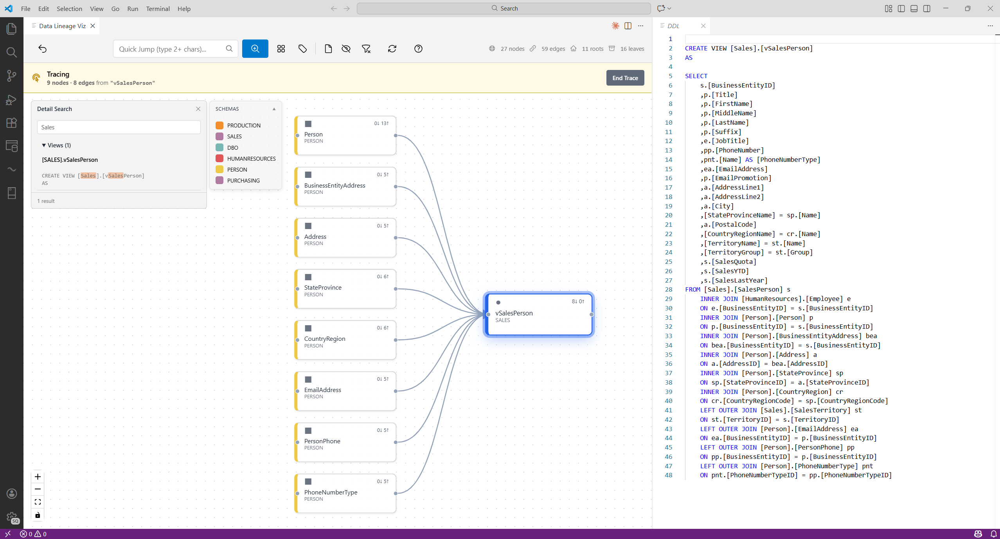

# Data Lineage Viz

Visualise SQL dependencies right inside VS Code. Browse your lineage graph with
search, trace, and Schema View.

Import from `.dacpac` files or connect directly to SQL Server, Azure SQL, Fabric Data Warehouse, or Synapse Dedicated SQL Pool.

▶ **[Watch the demo](https://www.youtube.com/watch?v=2Ybg2daCrB0)**

## Get started

1. Run **Data Lineage: Open Wizard** (`Ctrl+Shift+P`).
2. Click **+ Create New Project**, then **Open .dacpac file…** or **Connect to database…** (see [Database projects](#database-projects)).
3. Select schemas and click **Visualize**.

No data? Click **Try with demo data** or run **Data Lineage: Open Demo** to explore the AdventureWorks sample.

## Database projects

Connect to SQL Server, Azure SQL, Fabric Data Warehouse, or Synapse Dedicated SQL Pool using built-in connections. They support SQL login or Microsoft Entra ID where supported by the platform; Fabric requires Entra ID.

Save, reuse, and manage connections from the wizard. Passwords are kept in VS Code’s secure storage.

Live projects read database metadata for lineage and can optionally profile table data. Use a login with read permissions only. See the [Developer Guide](docs/DEVELOPER_GUIDE.md#two-ingestion-paths-one-model) for the ingestion paths and [Troubleshooting](docs/TROUBLESHOOTING.md#import-and-connection) for setup, permissions, and connection help.

## Explore your lineage

Once your model loads, the visual graph is ready to use:

- **Data Lineage: Search Objects** finds any table, view, procedure, or function instantly and focuses it in the graph.
- **Trace dependencies** — follow sources upstream or consumers downstream from any node.
- **See the blast radius** — spot hubs, islands, orphans, and circular dependencies before you change anything.
- **Read the SQL** — right-click an object to open its DDL or table details; full-text search across procedure and view bodies.

## AI chat panel

The graph view has its own chat pane (click **Chat** on its right edge) that answers lineage questions on the loaded model with a model you configure. Details: [`docs/FEATURES.md`](docs/FEATURES.md#ai-chat-panel).

- **`dataLineageViz.ai.models`** lists OpenAI-compatible endpoints (Chat Completions or Responses; an Azure `/openai/v1/` base URL or Anthropic's `/v1/` chat-completions URL works like any other). The pane's picker offers them, with an effort picker where the entry supports it.
  An invalid entry is named and not offered; `dataLineageViz.ai.defaultModel` names the one to use.
- **Data Lineage: Add AI Model** (or **Add model** in the chat) guides you through a provider preset, endpoint, model, limits and key, tests the connection and saves the entry; **Edit AI Model**, **Remove AI Model** and **Update AI Model Key** manage it later. The key is stored in VS Code's secret storage; it is never written to settings, logs or the webview.
- **Guided exploration** — `/search` answers from lookup tools; `/trace` or a large question proposes a hop-by-hop exploration that runs only after you approve, refine or cancel the plan.

## MCP server

Run **Data Lineage: Enable MCP Server** (or set `dataLineageViz.mcp.enabled`) to let local MCP clients such as Claude Code or Copilot agent mode call the read-only lineage tools. It does not need the chat panel or `dataLineageViz.ai.enabled`. Tools, access token and revocation: [`docs/FEATURES.md`](docs/FEATURES.md#mcp-server).

The visual graph, search, trace, SQL preview, demo data, profiling, and export features work without any of this.

## Features

- **Interactive graph** — search objects, trace upstream or downstream, and find shortest paths between nodes.
- **Graph analysis** — identify islands, hubs, orphans, circular dependencies, and long dependency chains.
- **Schema View** — large graphs auto-summarise at schema level; double-click to drill in.
- **SQL preview** — inspect DDL with syntax highlighting and search across procedure / view bodies.
- **AI chat panel** — ask lineage questions in a chat pane docked in the graph, on OpenAI-compatible endpoints you configure (keys in secret storage); `/search`, `/trace` and approval before hop-by-hop exploration.
- **Multiple sources** — SSDT and SDK-style `.dacpac` files, live database connections, external tables, and virtual external refs (OPENROWSET, cross-DB, CETAS).
- **Projects & views** — save connections, schema selections, and named filter states for one-click reopen.
- **Table profiling** — on-demand column statistics for live databases (null %, distinct, min / max, AVG, STDEV).
- **Export** — Draw.io diagram generation.

For the full feature catalogue, settings, and customisation paths see [`docs/FEATURES.md`](docs/FEATURES.md).

## Limitations

The lineage graph is built from database DDL/catalog metadata only. The following are out of scope:

- **External ingestion pipelines** — ADF, SSIS, Spark, Fabric Dataflow, or any ETL/ELT process that writes *into* the database from an external source. Target tables appear as leaves; the upstream pipeline does not.
- **Cross-database / cross-server flow** — fully qualified three- or four-part references can surface as virtual external nodes, but the remote database internals are not introspected.
- **Dynamic SQL** — `EXEC(@sql)` and `sp_executesql` cannot be analysed statically.
- **Unqualified references** — references without a schema prefix are ambiguous; metadata may resolve some known dependencies, but dynamic/default-schema cases may not resolve.
- **Triggers, synonyms and other object kinds** — only tables, views, functions, stored procedures and external objects are loaded. Triggers, synonyms, CLR modules, extended stored procedures, sequences and user-defined types are not: they do not appear as nodes, and references made through them do not become edges.
- **Features that are not database objects** — built-in and function-style features (JSON, XML, vector, `PREDICT`, SQL Graph syntax), types, column methods and variables are ignored. The tables around them are read as usual.
- **Unreadable definitions** — a stored procedure created `WITH ENCRYPTION`, or one whose definition the connected user may not view, is shown as a node without dependencies and marked with a warning; its body cannot be read.

Supported platforms are SQL Server, Azure SQL, Fabric Data Warehouse and Synapse Dedicated SQL Pool. Synapse serverless SQL pool is not supported. The parse details are in [`docs/PARSE_RULES.md`](docs/PARSE_RULES.md).

## FAQ

**Do I need a `.dacpac` file?**
No — connect directly to a database. If you prefer a `.dacpac`, extract one from Visual Studio, SSMS, Azure Data Studio, or the Fabric portal. See [Microsoft's documentation](https://learn.microsoft.com/sql/relational-databases/data-tier-applications/data-tier-applications).

**Why are some dependencies missing?**
Dynamic SQL cannot be analysed statically. Only dependencies visible in compiled metadata or parseable SQL bodies are detected.

**Why are unqualified references unreliable?**
Unqualified names depend on caller default schema and context. Schema-qualified names are the only reliable source for static lineage.

## Documentation

- [`docs/FEATURES.md`](docs/FEATURES.md) — full feature catalogue, settings, customisation paths.
- [`docs/ARCHITECTURE.md`](docs/ARCHITECTURE.md) — how the lineage graph is built and where the optional AI fits in.
- [`docs/DEVELOPER_GUIDE.md`](docs/DEVELOPER_GUIDE.md) — toolchain, build and run, ingestion and parsing overview.
- [`docs/DMV_QUERIES.md`](docs/DMV_QUERIES.md) — DBA contract for live-database ingestion (no black box).
- [`docs/PROFILING_PATTERNS.md`](docs/PROFILING_PATTERNS.md) — generated SQL for table profiling.
- [`docs/PARSE_RULES.md`](docs/PARSE_RULES.md) — YAML reference for the SQL parser.
- [`docs/AI_PROMPTS.md`](docs/AI_PROMPTS.md) — YAML reference for the AI output templates.
- [`docs/TROUBLESHOOTING.md`](docs/TROUBLESHOOTING.md) — common issues.
- [`CONTRIBUTING.md`](CONTRIBUTING.md) — bug reports and forking.

## Contributing

Bug reports welcome. For custom features, fork and extend under the MIT license. See [`CONTRIBUTING.md`](CONTRIBUTING.md).

---

MIT License · [Christian Wagner](https://www.linkedin.com/in/christian-wagner-11aa8614b) · [GitHub](https://github.com/ChrisDevRepo/vscode_data_lineage)
