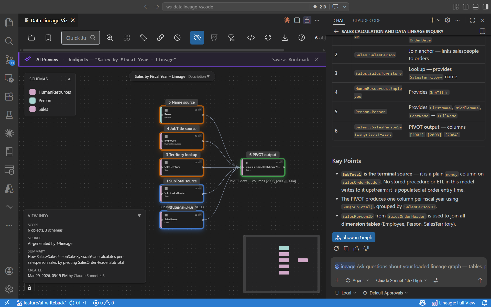
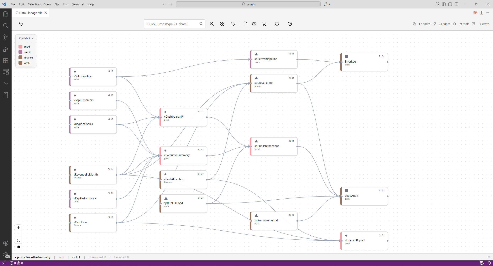

# Data Lineage Viz

[](LICENSE)
[](https://marketplace.visualstudio.com/items?itemName=datahelper-chwagner.data-lineage-viz)


Visualise SQL dependencies right inside VS Code. Browse your lineage graph with
search, trace, and Schema View — and, with a VS Code Language Model Chat
provider such as GitHub Copilot, ask `@lineage` to explore the loaded model in
natural language.

Import from `.dacpac` files or connect directly to SQL Server, Azure SQL, Fabric Data Warehouse, or Synapse Dedicated SQL Pool.

[](https://www.youtube.com/watch?v=2Ybg2daCrB0)

▶ **[Watch the demo](https://www.youtube.com/watch?v=2Ybg2daCrB0)**

## Get started

1. Run **Data Lineage: Open Wizard** (`Ctrl+Shift+P`).
2. Pick a `.dacpac` file — or **Connect to Database** (see [Database projects](#database-projects)).
3. Select schemas and click **Visualize**.

No data? Click **Try with demo data** or run **Data Lineage: Open Demo** to explore the AdventureWorks sample.

## Database projects

Connect to SQL Server, Azure SQL, Fabric Data Warehouse, or Synapse Dedicated SQL Pool using SQL login or Microsoft Entra ID where supported by the platform; Fabric requires Entra ID. Windows authentication is not supported.

Save, reuse, and manage connections from the wizard. Passwords are kept in VS Code’s secure storage.

Live projects read database metadata for lineage and can optionally profile table data. Use a login with read permissions only. See [`docs/DMV_QUERIES.md`](docs/DMV_QUERIES.md) for every query the import runs, and [Troubleshooting](docs/TROUBLESHOOTING.md#import-and-connection) for setup, permissions, and connection help.

## Optional AI lineage with `@lineage`

With a VS Code Language Model Chat provider, `@lineage` adds natural-language
exploration on top of the visual graph. The extension passes exactly the model
selected for the chat request and constrains the assistant to the loaded data
model.

```text
@lineage trace from Sales.SalesOrderDetail upstream to the source tables
@lineage how is sales calculated — show me the lineage in the app
@lineage which objects are hubs with the most connections?
```



`@lineage` answers in chat from deterministic tools by default (`/search` pins this), offers a **Show graph preview** in the side panel, and for `/trace`, a named-column trace or an over-budget question shows the planned scope and waits for your approval before it walks the graph hop by hop. Details: [`docs/FEATURES.md`](docs/FEATURES.md#lineage-ai). Column mappings are model interpretations; verify them against the SQL.

The graph, search, trace, SQL preview, demo data, profiling and export work without a model provider.

## Requirements, settings and privacy

- VS Code 1.101 or later. `@lineage` additionally needs a VS Code Language Model Chat provider, such as [GitHub Copilot](https://marketplace.visualstudio.com/items?itemName=GitHub.copilot) or a compatible BYOK provider. A database import needs a login with `VIEW DEFINITION` (and `SELECT` on a table to profile it); see [`docs/DMV_QUERIES.md`](docs/DMV_QUERIES.md).
- Settings: search "dataLineageViz" in VS Code Settings or run **Data Lineage: Settings**; every setting is described in [`docs/FEATURES.md`](docs/FEATURES.md#settings-reference).
- Privacy: the extension has no telemetry and sends nothing to its author. A `.dacpac` is parsed locally. A database import and table statistics run only when you start them, with the SQL listed in [`docs/DMV_QUERIES.md`](docs/DMV_QUERIES.md) and [`docs/PROFILING_PATTERNS.md`](docs/PROFILING_PATTERNS.md). Only `@lineage` sends data to a model: your question, recent `@lineage` chat, and the SQL or metadata its tools read from the loaded graph go to the chat model you selected in VS Code. Set `dataLineageViz.ai.enabled` to `false` to remove it. Details: [`SECURITY.md`](SECURITY.md).

## Features



- **Interactive graph** — **Data Lineage: Search Objects** finds any table, view, procedure or function; trace upstream or downstream from any node; find shortest paths between nodes.
- **Graph analysis** — spot islands, hubs, orphans, circular dependencies and long chains before you change anything.
- **Schema View** — large graphs auto-summarise at schema level; double-click to drill in.
- **SQL preview** — open an object's DDL or table details; full-text search across procedure and view bodies.
- **Optional `@lineage` AI** — natural-language questions about the loaded model; `#lineageView` shares what is on screen; a bookmark saved from an AI view keeps that run's findings for later recall.
- **Multiple sources** — SSDT and SDK-style `.dacpac` files, live database connections, external tables, and virtual external refs (OPENROWSET, cross-DB, CETAS).
- **Projects & views** — save connections, schema selections and named filter states for one-click reopen.
- **Table profiling** — on-demand column statistics for live databases (null %, distinct, min / max, AVG, STDEV).
- **Export** — Draw.io diagram generation.

The full catalogue and settings: [`docs/FEATURES.md`](docs/FEATURES.md).

## Limitations

The lineage graph is built from database DDL/catalog metadata only. The following are out of scope:

- **External ingestion pipelines** — ADF, SSIS, Spark, Fabric Dataflow, or any ETL/ELT process that writes *into* the database from an external source. Target tables appear as leaves; the upstream pipeline does not.
- **Cross-database / cross-server flow** — fully qualified three- or four-part references can surface as virtual external nodes, but the remote database internals are not introspected.
- **Dynamic SQL** — `EXEC(@sql)` and `sp_executesql` cannot be analysed statically.
- **Unqualified references** — references without a schema prefix are ambiguous; metadata may resolve some known dependencies, but dynamic/default-schema cases are not guaranteed.
- **Triggers, synonyms and other object kinds** — only tables, views, functions, stored procedures and external objects are loaded. Triggers, synonyms, CLR modules, extended stored procedures, sequences and user-defined types are not: they do not appear as nodes, and references made through them do not become edges.
- **Features that are not database objects** — built-in and function-style features (JSON, XML, vector, `PREDICT`, SQL Graph syntax), types, column methods and variables are ignored. The tables around them are read as usual.
- **Unreadable definitions** — a stored procedure created `WITH ENCRYPTION`, or one whose definition the connected user may not view, is shown as a node without dependencies and marked with a warning; its body cannot be read.

Supported platforms are SQL Server, Azure SQL, Fabric Data Warehouse and Synapse Dedicated SQL Pool. Synapse serverless SQL pool is not supported. The parse details are in [`docs/PARSE_RULES.md`](docs/PARSE_RULES.md).

## FAQ

**Do I need a `.dacpac` file?**
No — connect directly to a database. If you prefer a `.dacpac`, extract one from Visual Studio, SSMS, Azure Data Studio, or the Fabric portal. See [Microsoft's documentation](https://learn.microsoft.com/sql/relational-databases/data-tier-applications/data-tier-applications).

## Documentation

- Users: [`docs/FEATURES.md`](docs/FEATURES.md) (features, settings), [`docs/TROUBLESHOOTING.md`](docs/TROUBLESHOOTING.md), [`CHANGELOG.md`](CHANGELOG.md).
- DBAs and security reviewers: [`SECURITY.md`](SECURITY.md) (what is read, run and sent; reporting), [`docs/DMV_QUERIES.md`](docs/DMV_QUERIES.md) (import queries, permissions), [`docs/PROFILING_PATTERNS.md`](docs/PROFILING_PATTERNS.md) (statistics SQL), [`docs/PARSE_RULES.md`](docs/PARSE_RULES.md) (parser and limits), [`docs/AI_PROMPTS.md`](docs/AI_PROMPTS.md) (`@lineage` templates).
- Developers: [`CONTRIBUTING.md`](CONTRIBUTING.md) (build, test, propose a change), [`docs/DEVELOPER_GUIDE.md`](docs/DEVELOPER_GUIDE.md), [`docs/ARCHITECTURE.md`](docs/ARCHITECTURE.md), [`docs/testing/README.md`](docs/testing/README.md), [`CODE_OF_CONDUCT.md`](CODE_OF_CONDUCT.md).

Bug reports are welcome; for custom features, fork and extend under the MIT license.

---

MIT License · [Christian Wagner](https://www.linkedin.com/in/christian-wagner-11aa8614b) · [GitHub](https://github.com/ChrisDevRepo/vscode_data_lineage)
