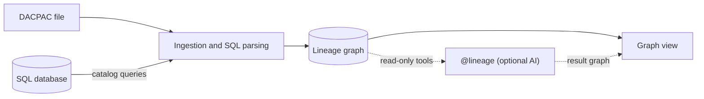

# Architecture

How Data Lineage Viz turns SQL metadata into a lineage graph, and how the optional `@lineage` chat helper builds on it. Build and test steps are in the [Developer Guide](DEVELOPER_GUIDE.md).

## Overview

The core is a deterministic object-lineage engine and a graph view. Search, tracing, path finding, analysis and table statistics all work without AI. `@lineage` is an optional chat helper on top of the loaded graph.

## Lineage engine

**Ingestion.** Input is a DACPAC file or a live database. A live database is read with the catalog (DMV) queries in [`DMV_QUERIES.md`](DMV_QUERIES.md): first a schema preview, then objects, columns, constraints and dependencies for the schemas you select. Both paths use the same object-graph model; their available metadata and SQL definitions can differ.

**Edges.** Edges come from two sources combined. The catalog or DACPAC lists which objects reference which, but not whether a procedure reads, writes or calls them. Configurable regex [parse rules](PARSE_RULES.md) read the SQL bodies to supply that direction: stored procedures get their reads, writes and calls from the rules, and views and functions use them to add references the metadata misses. A catalog dependency no rule captured is retained when its endpoints resolve. Physical mutation detection supplements the rules to classify writes and delete-only edges; the remaining references use the object-type fallback described in the parse-rules reference.

**Graph.** The result is one directed, object-level graph: which object reads, writes or calls which, not which column feeds which. Tracing, path finding and pattern analysis run on it, and a React webview draws it.

**Table statistics.** Profiling is separate from lineage. It runs only when you request it, on its own connection; see [`PROFILING_PATTERNS.md`](PROFILING_PATTERNS.md).

## Data access

**Database import.** Runs the built-in read-only catalog queries in [`DMV_QUERIES.md`](DMV_QUERIES.md) when you start an import. A configured custom DMV file supplies executable SQL and must be reviewed before use.

**Table statistics.** Runs row-count and aggregate queries on a table when you request them. Setting: `dataLineageViz.tableStatistics.enabled`.

**`@lineage`.** Sends the question, recent chat and the SQL or metadata it reads to the chat model selected in VS Code. Setting: `dataLineageViz.ai.enabled`.

Database connections use SQL login or Microsoft Entra ID. AI trace files are written only when enabled.

## Code map

| Directory | Contents |
|---|---|
| `src/engine/` | Ingestion, SQL parsing, graph building, tracing, profiling, database connections |
| `src/bridge/` | Host handlers for webview messages |
| `src/components/`, `src/hooks/` | React graph view |
| `src/ai/` | Optional `@lineage` chat participant, its tools and prompts |
| `assets/` | Built-in parse rules, DMV queries, output templates, demo DACPAC |

## Optional AI: `@lineage`

`@lineage` runs in VS Code Chat with your selected compatible model provider. A hosted provider needs network access; offline AI depends on whether your provider supports local operation. Its catalog tools read the loaded graph and SQL definitions; it cannot connect to a database or run SQL. Its result is a highlighted subgraph with a written explanation.

A small question is answered directly in chat. A larger one becomes an exploration plan that you approve, change or cancel; the approved plan is then walked object by object, and the findings are written up as the answer and a result graph.

### Exploration

Each step is a **hop**: the AI reads one object's SQL or available metadata, records what it does, and supplies decisions and questions for its neighbors. The engine validates the submission with deterministic checks and answers ACK or REJECT; a REJECT names the failing part and how to repair it ([backend contract](../.agents/rules/backend-contract.md)). Explicit passthrough forwards the incoming question within the approved scope. At a bodyless upstream focus, it can also carry an unresolved qualified output to its writers without asserting a value edge; their SQL resolves that output. These checks do not establish that the AI interpreted the SQL correctly. If correction cannot produce a valid answer, the run stops with an error naming the object.

Kept hops preserve accepted column mappings in the trace. The receiving hop resolves the assigned endpoint's continuation or finality; a final endpoint retains the accepted mapping. A table's downstream passthrough instead sends its qualified stored columns to each eligible reader as consumption candidates. Each reader's SQL establishes which values contribute, where they continue, and which inputs stop on that branch. An unused candidate creates no reader column edge and does not remove the table's columns or another reader's mappings. A declared write assigns only the destination's endpoints to that destination; the producer's output ports remain evidence, not additional tasks for the table's readers.

BB and CT use one optional `lineage_prune_current` command on a hop reached through passthrough. The AI can declare the whole object irrelevant and hard-cut it, with unvisited nodes removed by the normal directed pruning rules. Shared branches survive. The cut removes column evidence belonging to removed objects and clears held findings; ordinary CT termination retains the object. Availability depends only on the engine-recorded passthrough route, preserved in snapshots. Both outcomes use the existing shared hop-completion path.

An exploration can carry object-level or column-level work:

- **BB** (object lineage) follows whole objects: which procedures and views feed a table, and what they do.
- **CT** (column trace) carries the columns relevant to the question: the AI reads each object's SQL and reports column contributions with their transforms; links that only join or filter are drawn dashed. The engine checks that each link targets an in-scope neighbour, names a declared column where metadata exists, and connects to a qualified input; it does not derive or reclassify the column links itself. Check the AI’s column links against the SQL.

### Large graphs and memory

Discovery catalog requests limit the graph material returned to the AI using `dataLineageViz.ai.discoveryNodeCap` and `dataLineageViz.ai.discoveryTokenBudget`; exploration admission is limited by `dataLineageViz.ai.maxRounds` hops.

Each hop uses sliding memory: the question and approved scope, the current object, its neighbors' columns, and short summaries of the last three hops. After each committed hop, the conversation restarts with continuation context rather than replaying every prior tool exchange. Prompt size still varies with SQL, scope and task context. The findings are kept by the engine and read once at the end to write the answer.

## Design boundaries

- `src/engine/` never imports `src/components/` or `src/ai/`.
- AI lineage tools read the loaded graph; model requests use the VS Code language-model API. The tools do not execute SQL.
- Tool calls and webview messages are schema-checked.
- Other VS Code agents can call the read-only lineage tools.
