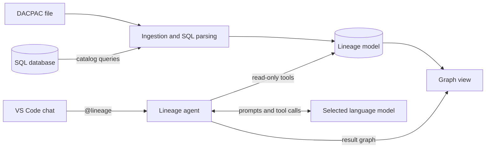
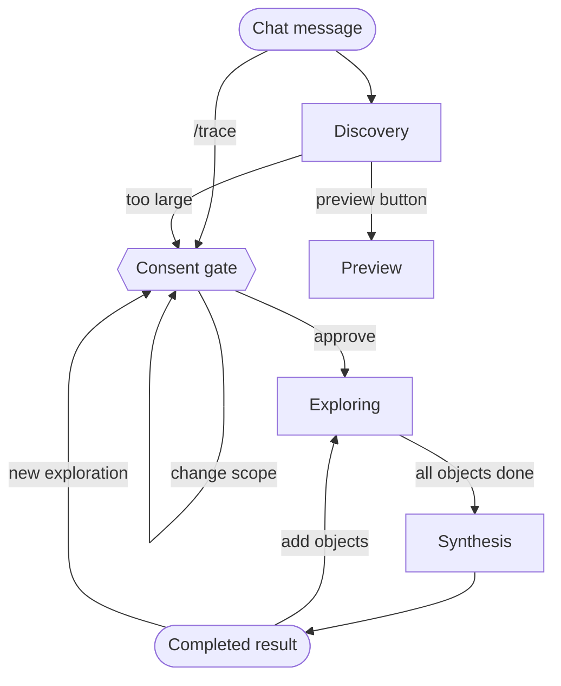

# Architecture

How Data Lineage Viz is built: the lineage engine that turns SQL into a graph, and the `@lineage` chat helper that explores that graph with a language model. Build and test steps are in the [Developer Guide](DEVELOPER_GUIDE.md).

## Overview

The **lineage engine** is deterministic. It loads objects, SQL bodies and dependencies from a DACPAC or a live database and builds one directed graph. The graph is object-level: it records which object reads, writes or calls which, not which column feeds which. A React webview draws it.

Edges come from two sources combined. The catalog or DACPAC lists which objects reference which, but not whether a procedure reads, writes or calls them. Configurable regex [parse rules](PARSE_RULES.md) read the SQL bodies to supply that direction: stored procedures get their reads, writes and calls from the rules, and views and functions use them to add references the metadata misses. A catalog dependency no rule captured is still drawn, with a default direction.

The **lineage agent** runs inside VS Code chat with the model the user selected. It works only on the loaded lineage model: it never connects to a database or runs SQL. Its result is a highlighted subgraph with a written explanation.

The agent is optional. The graph, search, tracing and analysis work without any model, and with a DACPAC the extension makes no network connections. `@lineage` reaches only the model picked in VS Code chat, through VS Code's language model API; with a Copilot bring-your-own-key (BYOK) provider such as Ollama that model can run locally.

## Code map

| Directory | Contents |
|---|---|
| `src/engine/` | Ingestion, SQL parsing, graph building, tracing, profiling, database connections |
| `src/bridge/` | Host handlers for webview messages |
| `src/components/`, `src/hooks/` | React graph view |
| `src/ai/participant/` | The `@lineage` chat participant |
| `src/ai/agent/` | Conversation phases (LangGraph) |
| `src/ai/sm/` | `NavigationEngine`, which drives an exploration |
| `src/ai/tools/`, `src/ai/prompting/` | Tools the model can call, and prompt builders |
| `assets/` | Built-in parse rules, DMV queries, output templates, demo DACPAC |

## The `@lineage` agent

A small question is answered directly in **discovery** with read-only tools. A question that needs more of the graph than the discovery budget allows becomes an exploration proposal. The **consent gate** shows its scope and waits for the user's approval. **Exploring** visits the objects one by one, and **synthesis** writes the answer and draws the result graph. Follow-ups can restyle the answer, add objects or start over.

## Exploration

The design splits the work: the model reads SQL and explains it, and the `NavigationEngine` owns everything structural (which objects are in scope, the visiting order, validation and when the run is done).

Each step is a **hop**: one model call on one object (a procedure, view or function; a table only when it is the starting object or named in a follow-up). The model sees that object's SQL and its neighbors' column lists, records its findings, and leaves each unvisited neighbor a note to skip it or a question to check. The engine visits every object once, removes a neighbor only when every hop that reaches it agrees, and keeps every visited object connected to the starting object.

Findings are committed atomically: the engine checks every neighbor, column and skip decision first and rejects a failing answer with the reason instead of repairing it. A hop has three replies to produce a valid answer; after that, or on an internal fault, the run stops with an error naming the object and shows no result.

Exploration runs in one of two modes, chosen at the gate:

- **BB** (object lineage) follows whole objects: which procedures and views feed a table, and what they do.
- **CT** (column trace) builds on BB: it follows named columns through the same objects and adds column detail.

### Column trace

Column lineage comes only from the language model. The engine traces objects; in CT the model reads each object's SQL and reports which source columns feed each traced column, and the engine checks every column it names against the loaded metadata. Column links are therefore AI findings, to be checked against the SQL.

In CT each hop also returns, per traced column, the source columns its value comes from, tagged as copied, computed, aggregated, or used only to shape rows (join, grouping, ordering or filter). Only value sources become column links. Procedures report the table column they write; a scalar function is traced through the caller column that uses it.

### Scope, readiness, and continuation

The approved scope fixes schemas, object types, exclusions and any exact depth; within that border a run can reach objects beyond the initial set. An object is visited only after the objects that send it notes are done; objects in a cycle are scheduled together. Column work is visited first. A hop runs in CT only when column work reaches it; anything unresolved is reported as an open lead.

### Large graphs and memory

The graph is never sent to the model whole. Discovery reads at most `dataLineageViz.ai.discoveryNodeCap` objects within `dataLineageViz.ai.discoveryTokenBudget` tokens; a larger question becomes an exploration of at most `dataLineageViz.ai.maxRounds` hops.

Each hop uses sliding memory. A fixed prefix carries the question, the approved scope and the discovery summary; the hop message adds only the current object, its neighbors' columns, the tasks arriving from earlier hops, the last three hop summaries and recent rejections. After each accepted hop the conversation restarts from one continuation message, so the prompt stays the same size however many objects a run visits. Findings go to an archive the engine keeps, and synthesis reads that archive once to write the answer.

### Results

The model writes the summary, sections and highlights; the engine resolves object ids, assembles the report and keeps the result graph connected to the starting object. Content the engine already holds, such as SQL snippets, is referenced by id instead of retyped by the model.

## Design boundaries

- `@lineage` uses only the model selected in VS Code chat.
- AI code reads the loaded model only; `src/ai` imports no database or network code.
- Tool calls and webview messages are schema-checked.
- Other VS Code agents can call the read-only lineage tools.
- `src/engine/` never imports `src/components/`.

## History, privacy, and no-egress boundary

The extension sends no usage data anywhere and adds no network destination for AI. The selected model receives the question, recent chat text, and the metadata or SQL the tools return. Across chat turns only question and answer text is replayed; the extension writes no tool results into chat result metadata, and a later turn reads facts again through the tools. Diagnostics stay local: the Output log, and NDJSON AI traces under `tmp/lm-trace/` once you enable them. Traces contain prompts, responses, SQL and object names; review them before sharing.
