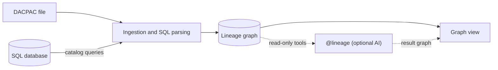
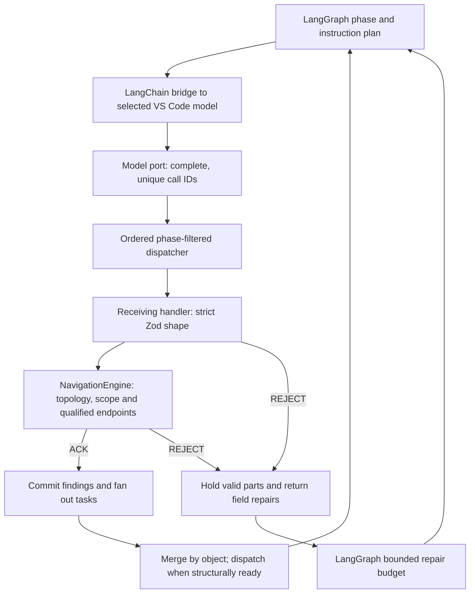

# Architecture

How Data Lineage Viz turns SQL metadata into a lineage graph, and how the optional `@lineage` chat helper builds on it. Build and test steps are in the [Developer Guide](DEVELOPER_GUIDE.md).

## Overview

The core is a deterministic object-lineage engine and a graph view. Search, tracing, path finding, analysis and table statistics all work without AI. `@lineage` is an optional chat helper on top of the loaded graph.

## Lineage engine

**Ingestion.** Input is a DACPAC file or a live database. A live database is read with the catalog (DMV) queries in [`DMV_QUERIES.md`](DMV_QUERIES.md): first a schema preview, then objects, columns, constraints and dependencies for the schemas you select. Both paths use the same object-graph model; their available metadata and SQL definitions can differ.

**Edges.** Edges come from two sources combined. The catalog or DACPAC lists which objects reference which, but not whether a procedure reads, writes or calls them. Configurable regex [parse rules](PARSE_RULES.md) read the SQL bodies to supply that direction: stored procedures get their reads, writes and calls from the rules, and views and functions use them to add references the metadata misses. A catalog dependency no rule captured is retained when its endpoints resolve. Physical mutation detection supplements the rules to classify writes and delete-only edges; the remaining references use the object-type fallback described in the parse-rules reference.

**Graph.** The result is one directed, object-level graph: which object reads, writes or calls which, not which column feeds which. Tracing, path finding and pattern analysis run on it, and a React webview draws it.

**Table statistics.** Profiling is separate from lineage. It runs only when you request it, on its own connection; see [`PROFILING_PATTERNS.md`](PROFILING_PATTERNS.md).

## Data access

**Database import.** Runs the built-in read-only catalog queries in [`DMV_QUERIES.md`](DMV_QUERIES.md) when you start an import. A configured custom DMV file supplies executable SQL and must be reviewed before use.

**Table statistics.** Runs row-count and aggregate queries on a table when you request them. Setting: `dataLineageViz.tableStatistics.enabled`.

**`@lineage`.** Sends the question, recent chat and the SQL or metadata it reads to the chat model selected in VS Code. Setting: `dataLineageViz.ai.enabled`.

Database connections use SQL login or Microsoft Entra ID. AI trace files are written only when enabled.

## Code map

| Directory | Contents |
|---|---|
| `src/engine/` | Ingestion, SQL parsing, graph building, tracing, profiling, database connections |
| `src/bridge/` | Host handlers for webview messages |
| `src/components/`, `src/hooks/` | React graph view |
| `src/ai/` | Optional `@lineage` chat participant, its tools and prompts |
| `assets/` | Built-in parse rules, DMV queries, output templates, demo DACPAC |

## Optional AI: `@lineage`

`@lineage` runs in VS Code Chat with your selected compatible model provider. A hosted provider needs network access; offline AI depends on whether your provider supports local operation. Its catalog tools read the loaded graph and SQL definitions; it cannot connect to a database or run SQL. Its result is a highlighted subgraph with a written explanation.

A small question is answered directly in chat. A larger one becomes an exploration plan that you approve, change or cancel; the approved plan is then walked object by object, and the findings are written up as the answer and a result graph.

### Exploration

Each SQL step is a **hop**: the AI reads the current object's definition, records findings and column mappings, and supplies a question for each open neighbor it keeps or a prune decision. The engine answers ACK or REJECT before committing ([backend contract](../.agents/rules/backend-contract.md)); a correction resends only the failed parts. The AI does not classify the current object as analyze or passthrough. These checks establish mechanical validity, not correct SQL interpretation.

The backend owns routing and visit-once scheduling. One neighbor projection supplies action capabilities to context, schemas, routing and rejection choices. A hop can change only its current findings and propose actions for its eligible unvisited neighbors; a distant object is not a valid neighbor prune target. Visited neighbors remain available as evidence but receive no new work or changes to their committed findings.

The neighbor projection and submission guard share the same prune action-state policy. Final prune validation also protects committed mappings and graph connectivity. Agenda column merging uses the shared SQL identifier comparison policy, preserving the first spelling and each task's identity. Question text is compared verbatim in both the task ledger and the agenda: case and whitespace inside a SQL literal can change the question even when catalog identifiers are case-insensitive. Identical resends reuse the same task.

The engine retains tables and external storage objects in the result and forwards their incoming questions automatically to eligible neighbors in the approved direction. The same route handles a table named by an approved follow-up. Qualified column endpoints travel as unconfirmed candidates, without invented value edges: each receiving SQL object establishes which values it writes or uses. Unused candidates end independently at that object, preserving table evidence and sibling branches. Stored DDL and column expressions remain available as metadata; a procedure, view or function with unavailable SQL still needs an explicit uncertainty finding.

A SQL hop reached only through storage forwarding receives the optional `lineage_prune_current` command when no committed column mapping protects it. It can remove an irrelevant object and its exclusive unvisited continuation; shared branches survive. Direct/root work receives no self-prune option. Neighbor pruning and self-pruning use the existing graph protection and hop-completion path. Kept findings preserve accepted mappings and legitimate final endpoints; later object-only work cannot restart ended column tasks.

An exploration can carry object-level or column-level work:

- **BB** (object lineage) follows whole objects: which procedures and views feed a table, and what they do.
- **CT** (column trace) carries the columns relevant to the question: the AI reads each object's SQL and reports column contributions with their transforms. The engine checks that each link targets an in-scope neighbour, names a declared column where metadata exists, and connects to a qualified input; it does not derive or reclassify the column links itself. Check the AI’s column links against the SQL.

### Routing order

The engine keeps open work as a list of hops, one per object, each holding its merged tasks. The order is not the list order: on every dispatch the engine computes the next ready hop from the live graph. A hop is ready when no unfinished object that can still reach it remains; objects in a cycle are scheduled as one unit. Ties go to column work, then follow-up requests, then distance from the origin. Scope, prunes and routes change after every hop, so the schedule is recomputed rather than precomputed.

### Large graphs and memory

Discovery catalog requests limit the graph material returned to the AI using `dataLineageViz.ai.discoveryNodeCap` and `dataLineageViz.ai.discoveryTokenBudget`; exploration admission is limited by `dataLineageViz.ai.maxRounds` hops.

Each hop uses sliding memory: the question and approved scope, the current object, its neighbors' columns, and short summaries of the last three hops. After each committed hop, the conversation restarts with continuation context rather than replaying every prior tool exchange. Prompt size still varies with SQL, scope and task context. The findings are kept by the engine and read once at the end to write the answer.

### Model messages and commit boundaries

Graph fan-out creates qualified investigation tasks; tool batches execute in provider order. Each call gets one correlated result. A successful gate, route change or phase completion closes the batch, so later siblings receive a non-execution result. Hop-completion commands share one slot per reply, including when the first command is rejected. Cancellation ends the turn without replaying a partially answered batch.

Missing or repeated call IDs fail the model response before any tool executes: an ambiguous transport envelope cannot carry a safe per-call repair. Native and headless transports share this guard. Correctable argument and domain failures use the shared rejection renderer and existing reply budget. Field choices appear from the second rejection. Held-section labels are added only for keyed repairs; indexed repairs identify their entries directly.

Internal validation corrections keep ordinary phase and hop progress in chat. Rejection reasons, affected fields, call outcomes and correction counters remain in debug logs, correlated by request and call identifiers. Chat still shows consent requests, coverage limitations and terminal failures. Changing the rejected field or reason does not reset the correction budget; accepted reads do not erase rejected completion submissions. Connection retries are logged separately from model corrections.

Report schema and runtime failures share indexed-field detection, strict patch schemas and held-list merging. A broken node-link list or preview start can be replaced without resending section bodies. The merged sections are checked against their original stage schema before rendering, and preview prose is reassembled from the cached discovery answer. Backend faults end the run rather than requesting a model repair.

The bridge translates messages and tools; it neither executes tools nor retries requests. Zod owns shape, the engine owns state and lineage validity, and LangGraph owns phase transitions and retries. Column endpoints and their authoring hop remain evidence provenance; valid recorded links do not establish exhaustive SQL analysis.

## Design boundaries

- `src/engine/` never imports `src/components/` or `src/ai/`.
- AI lineage tools read the loaded graph; model requests use the VS Code language-model API. The tools do not execute SQL.
- Tool calls and webview messages are schema-checked.
- Other VS Code agents can call the read-only lineage tools.
