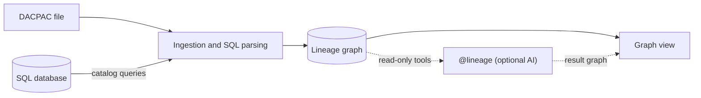

# Architecture

How Data Lineage Viz turns SQL metadata into a lineage graph, and how the optional `@lineage` chat helper builds on it. Build and test steps are in the [Developer Guide](DEVELOPER_GUIDE.md).

## Overview

The core is a deterministic object-lineage engine and a graph view. Search, tracing, path finding, analysis and table statistics all work without AI. `@lineage` is an optional chat helper on top of the loaded graph.

## Lineage engine

**Ingestion.** Input is a DACPAC file or a live database. A live database is read with the catalog (DMV) queries in [`DMV_QUERIES.md`](DMV_QUERIES.md): first a schema preview, then objects, columns, constraints and dependencies for the schemas you select. Both paths use the same object-graph model; their available metadata and SQL definitions can differ.

**Edges.** Edges come from two sources combined. The catalog or DACPAC lists which objects reference which, but not whether a procedure reads, writes or calls them. Configurable regex [parse rules](PARSE_RULES.md) read the SQL bodies to supply that direction: stored procedures get their reads, writes and calls from the rules, and views and functions use them to add references the metadata misses. A catalog dependency no rule captured is retained when its endpoints resolve. Physical mutation detection supplements the rules to classify writes and delete-only edges; the remaining references use the object-type fallback described in the parse-rules reference.

**Graph.** The result is one directed, object-level graph: which object reads, writes or calls which, not which column feeds which. Tracing, path finding and pattern analysis run on it, and a React webview draws it.

**Table statistics.** Profiling is separate from lineage. It runs only when you request it, on its own connection; see [`PROFILING_PATTERNS.md`](PROFILING_PATTERNS.md).

## Data access

**Database import.** Runs the built-in read-only catalog queries in [`DMV_QUERIES.md`](DMV_QUERIES.md) when you start an import. A configured custom DMV file supplies executable SQL and must be reviewed before use.

**Table statistics.** Runs row-count and aggregate queries on a table when you request them. Setting: `dataLineageViz.tableStatistics.enabled`.

**`@lineage`.** Sends the question, recent chat and the SQL or metadata it reads to the chat model selected in VS Code. Setting: `dataLineageViz.ai.enabled`.

Database connections use SQL login or Microsoft Entra ID. AI trace files are written only when enabled.

## Code map

| Directory | Contents |
|---|---|
| `src/engine/` | Ingestion, SQL parsing, graph building, tracing, profiling, database connections |
| `src/bridge/` | Host handlers for webview messages |
| `src/components/`, `src/hooks/`, `src/contexts/`, `src/detail/` | React graph view and detail panel |
| `src/ai/` | Optional `@lineage` chat participant, its tools and prompts |
| `assets/` | Built-in parse rules, DMV queries, output templates, demo DACPAC |

## Optional AI: `@lineage`

`@lineage` runs in VS Code Chat with your selected compatible model provider. A hosted provider needs network access; offline AI depends on whether your provider supports local operation. Its catalog tools read the loaded graph and SQL definitions; it cannot connect to a database or run SQL. Its result is a highlighted subgraph with a written explanation.

A small question is answered in chat; a larger one becomes a plan you approve, change or cancel before its object-by-object walk. New SQL work after an answer needs a fresh approval card; view or text edits can reuse the completed result.

### Exploration

A deep analysis walks the approved scope one SQL object at a time (a **hop**): the AI reads the object's definition and records findings, and the engine validates each reply, routes the next objects and rejects invalid replies with a specific correction. Tables and external storage objects are passed through without a model call. These checks establish mechanical validity, not correct SQL interpretation. An exploration follows whole objects (**BB**, object lineage) or the columns relevant to the question (**CT**, column trace); the engine does not derive column links itself, so check them against the SQL. Limits: `dataLineageViz.ai.maxRounds`, `dataLineageViz.ai.maxTraceColumns`, `dataLineageViz.ai.discoveryNodeCap` and `dataLineageViz.ai.discoveryTokenBudget`.

## Design boundaries

- `src/engine/` never imports `src/components/` or `src/ai/`.
- AI lineage tools read the loaded graph; model requests use the VS Code language-model API. The tools do not execute SQL.
- Tool calls and webview messages are schema-checked.
- Other VS Code agents can call the read-only lineage tools.
