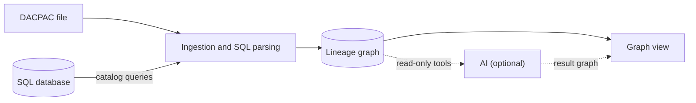
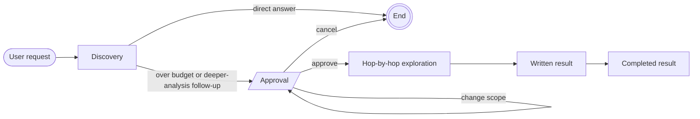

# Architecture

The extension builds an object-level lineage graph from a DACPAC file or a live
database and draws it in a webview. The optional AI works on the loaded graph
through read-only tools and the OpenAI-compatible model endpoints the user configures.

Build, ingestion, and host/webview details: [`DEVELOPER_GUIDE.md`](DEVELOPER_GUIDE.md).
Prompt and template behavior: [`AI_PROMPTS.md`](AI_PROMPTS.md).

## Architectural boundaries

- The AI uses one provider kind: an OpenAI-compatible endpoint (Chat Completions
  or Responses) listed in `dataLineageViz.ai.models`. Its API key is kept in VS Code
  secret storage under the entry id, never in settings, logs or the webview.
- AI code works on the loaded lineage model. It can read object and SQL
  definitions. It cannot connect to a database, run SQL, start an import, or
  start table statistics.
- Model tools go through one local registry. Read-only tools are also
  registered with VS Code for other agents.
- The model reads the SQL and writes the column mappings, so results are its
  reading of the SQL, best-effort and not complete.

## Overview

- **Ingestion and parser.** Reads a DACPAC or runs catalog queries, parses SQL
  bodies with the YAML parse rules, and builds one directed object graph.
- **Graph view.** A webview draws the graph. Search, tracing, path finding,
  graph analysis and table statistics work without AI.
- **AI.** An optional helper on top of the loaded graph.

## Optional AI

- **Discovery.** A question is first answered in chat from read tools over the
  loaded model; `/search` pins this path. A request above
  `dataLineageViz.ai.discoveryNodeCap` or `dataLineageViz.ai.discoveryTokenBudget`
  is offered as a deep analysis instead.
- **Approval.** `/trace`, the **Start deeper hop-by-hop
  analysis** follow-up or an over-budget request first shows the plan; no hop
  runs before approval. The plan must fit `dataLineageViz.ai.maxRounds` and
  `dataLineageViz.ai.maxTraceColumns`.
- **Hop-by-hop exploration.** One procedure, view or function is read per step.
  The model records findings and the extension decides which objects come
  next. Column mappings are the model's reading of the SQL, best-effort and not
  complete. What the plan shows: [`FEATURES.md`](FEATURES.md#ai).
- **Memory.** Findings are kept per chat session; a bookmark saved from an AI
  view keeps them for later questions.

## Database connection and data access

Live ingestion opens one connection per operation with the built-in driver.
Sign-in methods, credential storage and connection settings are in
[`SECURITY.md`](../SECURITY.md#connections).

| Source | What runs | When |
|---|---|---|
| DACPAC | Local unzip and parse of `model.xml` | Opening the file; no connection |
| Database import | Built-in read-only catalog (DMV) queries, listed in [`DMV_QUERIES.md`](DMV_QUERIES.md); a custom DMV file runs as written | When an import starts |
| Table statistics | Row-count and aggregate `SELECT` queries ([`PROFILING_PATTERNS.md`](PROFILING_PATTERNS.md)) | When requested for one table, on its own connection |
| AI | Nothing against a database; its tools read the loaded model | Optional, per request |

## History, privacy, and no-egress boundary

- Conversation history is ordered user and assistant text, bounded by turn
  count and bytes. Tool calls and results are not replayed across turns; a later
  turn reads facts again through the read tools.
- The extension sends data only to the databases the user connects to and, for
  AI, to the endpoint of the model entry in use. A hosted model receives the
  prompt, the conversation history, and the object metadata and SQL the tools return.
  Entra sign-in contacts Microsoft through VS Code and also calls Azure Resource
  Manager to list directories ([`SECURITY.md`](../SECURITY.md#connections)).
- The extension has no telemetry and makes no other network calls. LangChain's
  `langsmith` dependency is replaced by an inert local stub and tracing flags
  are rejected.
- AI trace logging and state dumps write to the workspace only when the user
  starts them; see [`SECURITY.md`](../SECURITY.md).
