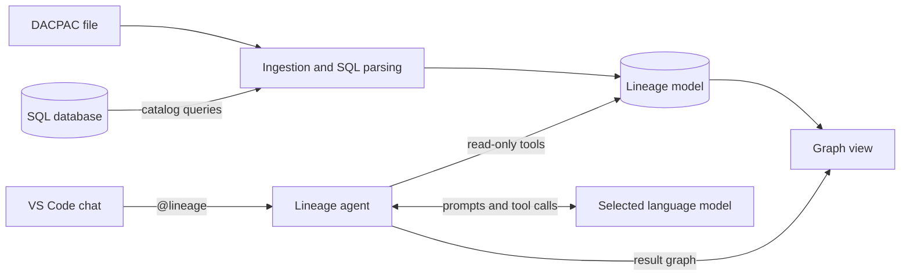

# Architecture

How Data Lineage Viz is built: the lineage engine that turns SQL into a graph, and the `@lineage` chat helper that explores that graph with a language model. Build and test steps are in the [Developer Guide](DEVELOPER_GUIDE.md).

## Overview

The **lineage engine** is deterministic. It loads objects, SQL bodies and dependencies from a DACPAC or a live database, finds table and procedure references with configurable regex rules, and builds one directed graph. A React webview draws it.

The **lineage agent** runs inside VS Code chat with the model the user selected. It works only on the loaded lineage model: it never connects to a database or runs SQL. Its result is a highlighted subgraph with a written explanation.

## Code map

| Directory | Contents |
|---|---|
| `src/engine/` | Ingestion, SQL parsing, graph building, tracing, profiling, database connections |
| `src/bridge/` | Host handlers for webview messages |
| `src/components/`, `src/hooks/` | React graph view |
| `src/ai/participant/` | The `@lineage` chat participant |
| `src/ai/agent/` | Conversation phases (LangGraph) |
| `src/ai/sm/` | `NavigationEngine`, which drives an exploration |
| `src/ai/tools/`, `src/ai/prompting/` | Tools the model can call, and prompt builders |
| `assets/` | Built-in parse rules, DMV queries, output templates, demo DACPAC |

## The `@lineage` agent

A small question is answered directly in **discovery** with read-only tools. A question that needs more of the graph than the discovery budget allows becomes an exploration proposal. The **consent gate** shows its scope and waits for the user's approval. **Exploring** visits the objects one by one, and **synthesis** writes the answer and draws the result graph. Follow-ups can restyle the answer, add objects or start over.

## Exploration

The design splits the work: the model reads SQL and explains it, and the `NavigationEngine` owns everything structural (which objects are in scope, the visiting order, validation and when the run is done).

Each step is a **hop**: one model call on one object (a procedure, view or function; a table only when it is the starting object or named in a follow-up). The model sees that object's SQL and its neighbors' column lists, records its findings, and leaves each unvisited neighbor a note to skip it or a question to check. The engine visits every object once, removes a neighbor only when every hop that reaches it agrees, and never cuts a visited object off from the starting object. A rejected answer goes back to the model with the reason; if a hop never produces a valid answer, the run stops with an error.

Exploration runs in one of two modes, chosen at the gate:

- **BB** (object lineage) follows whole objects: which procedures and views feed a table, and what they do.
- **CT** (column trace) builds on BB: it follows named columns through the same objects and adds column detail.

### Column trace

In CT each hop also returns, per traced column, the source columns its value comes from, tagged as copied, computed, aggregated, or used only to shape rows (join, grouping, ordering or filter). Only value sources become column links. Every column is checked against the loaded metadata. Procedures report the table column they write; a scalar function is traced through the caller column that uses it.

### Scope, readiness, and continuation

The approved scope fixes schemas, object types, exclusions and any exact depth; within that border a run can reach objects beyond the initial set. An object is visited only after the objects that send it notes are done; objects in a cycle are scheduled together. Column work is visited first. A hop runs in CT only when column work reaches it; anything unresolved is reported as an open lead.

## Design boundaries

- `@lineage` uses only the model selected in VS Code chat.
- AI code reads the loaded model only; `src/ai` imports no database or network code.
- Tool calls and webview messages are schema-checked.
- Other VS Code agents can call the read-only lineage tools.
- `src/engine/` never imports `src/components/`.

## History, privacy, and no-egress boundary

The extension has no telemetry and adds no network destination for AI. The selected model receives the question, recent chat text, and the metadata or SQL the tools return. Opt-in local traces can contain SQL and object names; review them before sharing.
