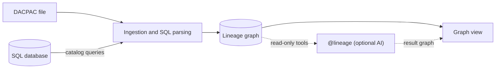
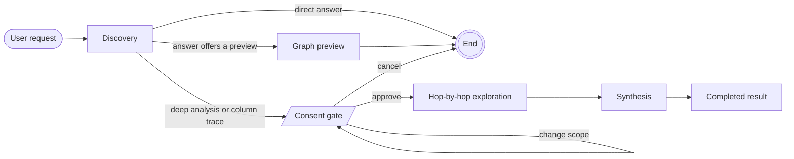

# Architecture

How Data Lineage Viz turns SQL metadata into a lineage graph, and how the optional `@lineage` chat participant builds on it. Build and test steps: [Developer Guide](DEVELOPER_GUIDE.md).

## Overview

The core is a deterministic object-lineage engine and a graph view. Search, tracing, path finding, graph analysis and table statistics work without AI. `@lineage` is an optional chat helper on top of the loaded graph.

## Lineage engine

- **Ingestion.** Input is a DACPAC file or a live database. A live import runs the catalog (DMV) queries in [`DMV_QUERIES.md`](DMV_QUERIES.md): a schema preview, then objects, columns, constraints and dependencies for the schemas you select. Both paths produce the same `DatabaseModel`; their metadata and SQL definitions can differ.
- **Edges.** The catalog or DACPAC says which objects reference which, not whether a procedure reads, writes or calls them. Configurable regex [parse rules](PARSE_RULES.md) read the SQL bodies to supply that direction; a catalog dependency no rule captured is kept, with its direction inferred from the object type.
- **Graph.** One directed, object-level graph: which object reads, writes or calls which. Tracing, path finding and pattern analysis run on it, and a React webview draws it. Column-level answers come only from the optional AI column trace.
- **Table statistics.** Separate from lineage; runs only when you request it, on its own connection ([`PROFILING_PATTERNS.md`](PROFILING_PATTERNS.md)).

## Data access

| Source | What runs | When |
|---|---|---|
| DACPAC | Local unzip and parse | Opening the file; no connection |
| Database import | Built-in read-only catalog queries ([`DMV_QUERIES.md`](DMV_QUERIES.md)); a custom DMV file runs as written | When you start an import |
| Table statistics | Row-count and aggregate `SELECT`s | When you request them for one table |
| `@lineage` | Nothing against a database; its tools read the loaded model | Optional, per chat request |

Live connections use the built-in `tedious` provider with SQL login or Microsoft Entra ID, `ReadOnly` application intent, and passwords in VS Code `SecretStorage`. Data boundaries: [`SECURITY.md`](../SECURITY.md).

## Code map

| Path | Owns |
|---|---|
| [`src/engine/`](../src/engine/) | Ingestion (`dacpacExtractor`, `dmvExtractor`), SQL parser (`sqlBodyParser`), model and graph builders, tracing, analysis, profiling, connection manager |
| [`src/engine/db/`](../src/engine/db/) | Built-in connection provider, saved connections, Entra sign-in, connection errors |
| [`src/engine/shared/`](../src/engine/shared/) | `bridgeContract.ts` (Zod webview message contract), shared types, SQL identifier helpers |
| [`src/bridge/`](../src/bridge/), [`src/panelProvider.ts`](../src/panelProvider.ts) | Host handlers and routing for webview messages |
| [`src/components/`](../src/components/), `src/hooks/`, `src/contexts/`, `src/detail/` | React webview: graph canvas, filters, detail panel, AI report |
| [`src/ai/`](../src/ai/) | `@lineage` participant, phase graph, navigation engine, tools, prompts, session memory |
| `src/export/`, `src/utils/` | Draw.io export; logging, notifications, redaction, layout worker |
| [`assets/`](../assets/) | Parse rules, DMV queries, AI output templates, demo DACPAC |
| [`tests/`](../tests/) | `unit/` (Vitest), `integration/` (VS Code host), `fixtures/`, `scale/`, `tools/` (gate and runners) |

## Optional AI: `@lineage`

`@lineage` runs in VS Code Chat with the model you selected for the request; the extension has no provider, endpoint, credential, model-picker or fallback setting. A hosted provider needs network access. Its tools read the loaded graph and SQL definitions and cannot connect to a database or run SQL. Its result is a highlighted subgraph with a written explanation.

- **Participant** ([`src/ai/participant/`](../src/ai/participant/)) adapts VS Code requests, history, cancellation, progress and buttons.
- **Phase graph** ([`src/ai/agent/graph.ts`](../src/ai/agent/graph.ts), LangGraph) owns phase transitions, semantic retries, synthesis and turn settlement. A small bridge ([`src/ai/model/`](../src/ai/model/)) wraps `vscode.lm` as the chat model; each model call is one `sendRequest`, with no fallback model; the graph retries a call once after 1 s when the connection drops before any reply.
- **Tools** ([`src/ai/tools/`](../src/ai/tools/)): one canonical registry with phase policy and strict Zod dispatch. `package.json` `languageModelTools` is the read-only subset other VS Code agents can call; tools that change exploration state stay on the participant.
- **Navigation engine** ([`src/ai/sm/smBase.ts`](../src/ai/sm/smBase.ts)) owns scope, agenda, validation, pruning and termination. The model proposes findings and neighbor decisions; it does not schedule hops or declare the exploration complete.

### Discovery and visual preview

A question is first answered in chat from deterministic catalog tools; `/search` pins this path. **Show graph preview** opens a bounded, transient **AI Preview**. A request above `dataLineageViz.ai.discoveryNodeCap` or `dataLineageViz.ai.discoveryTokenBudget` is offered as deep analysis instead. User view: [`FEATURES.md`](FEATURES.md#how-it-answers).

### Consent gate and exploration

`/trace`, a named-column trace, the **Start deeper hop-by-hop analysis** follow-up or an over-budget request first shows the plan; no hop runs before approval, and the approved scope must fit `dataLineageViz.ai.maxRounds` and `dataLineageViz.ai.maxTraceColumns`.

An exploration walks the approved scope one SQL object at a time (a **hop**): the model reads the object's definition and records findings, and the engine validates each reply and routes the next objects. Tables and other objects without a SQL body get no analysis hop of their own. Two modes: **BB** follows whole objects; **CT** (column trace) adds column tracking on the same object graph, and follows only columns whose value produces the traced column; join, filter, group and order columns are explained, not traced. The engine checks identities and routes; the model owns whether its SQL reading is complete, so verify column mappings against the SQL.

### Memory and bookmarks

Findings accumulate in `AiSession` ([`src/ai/session/`](../src/ai/session/)); a bookmark saved from an AI view keeps them with a hash of each object's DDL, so a later question can recall them and flag stale ones.

## Design boundaries

- `src/engine/` never imports `src/components/` or `src/ai/` (the gate checks layer direction). `src/ai` never imports the connection modules, so the AI surface cannot open a connection.
- Webview messages and tool calls are schema-checked at the receiving boundary. A tool rejection names the broken rule so the model can resend; the engine never repairs or completes model content.
- Prompts state the task, tool schemas own field contracts, and output templates own presentation ([`AI_PROMPTS.md`](AI_PROMPTS.md)).

## History, privacy, and no-egress boundary

- Chat history is projected as ordered user and assistant text, bounded by turn count and bytes. Tool calls and results are not replayed across turns or stored in VS Code's chat store; a later turn re-reads facts through the read tools.
- The extension makes no network calls of its own besides database connections and the selected model through `vscode.lm`. LangChain's transitive `langsmith` resolves to the inert stub in `stubs/langsmith/` ([`DEVELOPER_GUIDE.md`](DEVELOPER_GUIDE.md#toolchain)), and the gate checks the real client is absent from the bundle.
