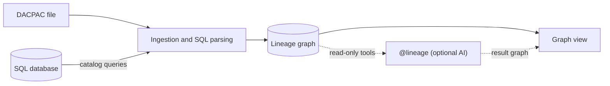
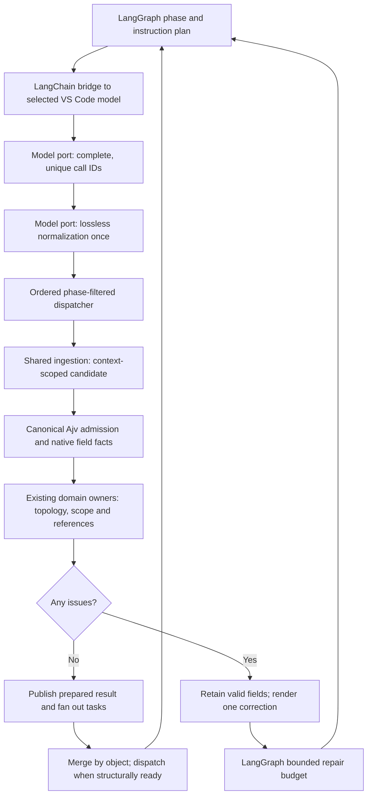

# Architecture

How Data Lineage Viz turns SQL metadata into a lineage graph, and how the optional `@lineage` chat helper builds on it. Build and test steps are in the [Developer Guide](DEVELOPER_GUIDE.md).

## Overview

The core is a deterministic object-lineage engine and a graph view. Search, tracing, path finding, analysis and table statistics all work without AI. `@lineage` is an optional chat helper on top of the loaded graph.

## Lineage engine

**Ingestion.** Input is a DACPAC file or a live database. A live database is read with the catalog (DMV) queries in [`DMV_QUERIES.md`](DMV_QUERIES.md): first a schema preview, then objects, columns, constraints and dependencies for the schemas you select. Both paths use the same object-graph model; their available metadata and SQL definitions can differ.

**Edges.** Edges come from two sources combined. The catalog or DACPAC lists which objects reference which, but not whether a procedure reads, writes or calls them. Configurable regex [parse rules](PARSE_RULES.md) read the SQL bodies to supply that direction: stored procedures get their reads, writes and calls from the rules, and views and functions use them to add references the metadata misses. A catalog dependency no rule captured is retained when its endpoints resolve. Physical mutation detection supplements the rules to classify writes and delete-only edges; the remaining references use the object-type fallback described in the parse-rules reference.

**Graph.** The result is one directed, object-level graph: which object reads, writes or calls which, not which column feeds which. Tracing, path finding and pattern analysis run on it, and a React webview draws it.

**Table statistics.** Profiling is separate from lineage. It runs only when you request it, on its own connection; see [`PROFILING_PATTERNS.md`](PROFILING_PATTERNS.md).

## Data access

**Database import.** Runs the built-in read-only catalog queries in [`DMV_QUERIES.md`](DMV_QUERIES.md) when you start an import. A configured custom DMV file supplies executable SQL and must be reviewed before use.

**Table statistics.** Runs row-count and aggregate queries on a table when you request them. Setting: `dataLineageViz.tableStatistics.enabled`.

**`@lineage`.** Sends the question, recent chat and the SQL or metadata it reads to the chat model selected in VS Code. Setting: `dataLineageViz.ai.enabled`.

Database connections use SQL login or Microsoft Entra ID. AI trace files are written only when enabled.

## Code map

| Directory | Contents |
|---|---|
| `src/engine/` | Ingestion, SQL parsing, graph building, tracing, profiling, database connections |
| `src/bridge/` | Host handlers for webview messages |
| `src/components/`, `src/hooks/`, `src/contexts/`, `src/detail/` | React graph view and detail panel |
| `src/ai/` | Optional `@lineage` chat participant, its tools and prompts |
| `assets/` | Built-in parse rules, DMV queries, output templates, demo DACPAC |

## Optional AI: `@lineage`

`@lineage` runs in VS Code Chat with your selected compatible model provider. A hosted provider needs network access; offline AI depends on whether your provider supports local operation. Its catalog tools read the loaded graph and SQL definitions; it cannot connect to a database or run SQL. Its result is a highlighted subgraph with a written explanation.

A small question is answered in chat; a larger one becomes a plan you approve, change or cancel before its object-by-object walk. New SQL work after an answer needs a fresh approval card; view or text edits can reuse the completed result.

### Exploration

Each SQL step is a **hop**: the AI reads the current object's definition, records findings and states a mapping, question or prune for every open neighbor. A missing outcome is rejected; valid fields stay held for an action-only correction. The engine continues mapped neighbors and answers ACK or REJECT before committing. The AI does not classify the current object as analyze or passthrough. These checks establish mechanical validity, not correct SQL interpretation.

**Mandatory AI/backend ownership gate:** before every recommendation or change, verify that semantic decisions and report content remain AI-owned. The backend persists supplied findings and reports; it must not infer, select, add or silently repair their meaning. Only lossless normalization and explicit index/reference expansion to supplied words or snippets transform content. Schema, reference, metadata, approved-scope and topology validation, persistence, routing and structural rendering (including lossless projection of stored AI graph values) remain technical; they do not authorize content invention. Review must reject a violation even when it is deterministic or convenient; do not add new guards; correct the shared schema, ingestion or existing domain-rule owner. The backend owns routing and visit-once scheduling. One neighbor projection supplies action capabilities to context, schemas, routing and rejection choices. A hop can change only its current findings and propose actions for its eligible unvisited neighbors; a distant object is not a valid neighbor prune target. Visited neighbors remain available as evidence but receive no new work or changes to their committed findings.

The backend manages pruning and connectivity while preserving committed mappings and the origin path. Identifier normalization preserves authored spelling. The AI selects report content; captured-SQL coverage is logged without rejecting omissions or adding excerpts. Explicit SQL references expand from captured blocks; invalid references and missing object sections request a focused repair while valid content stays held.

The engine retains tables and external storage objects in the result and forwards their incoming questions automatically to eligible neighbors in the approved direction. The same route handles a table named by an approved follow-up. Qualified column endpoints travel as unconfirmed candidates, without invented value edges: each receiving SQL object establishes which values it writes or uses. Unused candidates end independently at that object, preserving table evidence and sibling branches. Stored DDL and column expressions remain available as metadata; a procedure, view or function with unavailable SQL still needs an explicit uncertainty finding.

A SQL hop reached only through storage forwarding receives the optional `lineage_prune_current` command when no committed column mapping protects it. It can remove an irrelevant object and its exclusive unvisited continuation; shared branches survive. Direct/root work receives no self-prune option. Neighbor pruning and self-pruning use the existing graph protection and hop-completion path. Kept findings preserve accepted mappings and legitimate final endpoints; later object-only work cannot restart ended column tasks.

An exploration can carry object-level or column-level work:

- **BB** (object lineage) follows whole objects: which procedures and views feed a table, and what they do.
- **CT** (column trace) carries the columns relevant to the question: the AI reads each object's SQL and reports column contributions with their transforms. The engine records every valid neighbor-and-column pair (many-to-many): the object is an in-scope neighbour and the column exists where metadata is present. `out_col` is limited to the columns that arrived at an upstream hop; a procedure keeps a free name (extra upstream sources of an arriving column stay allowed). Attachment to the requested chain selects which columns carry into the next hop; extra valid pairs are not rejected. The engine does not derive or reclassify the column links itself. Check the AI’s column links against the SQL.

### Routing order

The engine keeps open work as a list of hops, one per object, each holding its merged tasks. The order is not the list order: on every dispatch the engine computes the next ready hop from the live graph. A hop is ready when no unfinished object that can still reach it remains; objects in a cycle are scheduled as one unit. Ties go to column work, then origin and follow-up requests, then distance from the origin. Scope, prunes and routes change after every hop, so the schedule is recomputed rather than precomputed.

### Large graphs and memory

Discovery catalog requests limit the graph material returned to the AI using `dataLineageViz.ai.discoveryNodeCap` and `dataLineageViz.ai.discoveryTokenBudget`; exploration admission is limited by `dataLineageViz.ai.maxRounds` hops and `dataLineageViz.ai.maxTraceColumns` starting columns.

Each hop uses sliding memory: the question and approved scope, the current object, its neighbors' columns, and short summaries of the last three hops (storage objects traversed without a model call do not displace hop summaries). After each committed hop, the conversation restarts with continuation context rather than replaying every prior tool exchange. Prompt size still varies with SQL, scope and task context. The findings are kept by the engine and read once at the end to write the answer.

### Model messages and commit boundaries

Tool batches execute in provider order with unique call IDs. Missing or repeated call IDs fail the model response before tool execution. A successful gate, route change or phase completion closes the active batch.

The shared ingestion controller stages the context-scoped candidate, invokes canonical validation once, collects independently decidable domain faults and makes one retain-or-publish decision. Native field facts preserve original array positions and distinguish valid, absent, invalid and inapplicable fields. An invalid parent stays unknown. Domain rules reuse the engine metadata and graph owners; validation never changes committed findings.

Zod owns structural schema authoring, types and normalization metadata. Ajv compiles canonical constraints with all errors enabled and coercion, defaults and property removal disabled. Canonical admission metadata stays private; the model receives the stable field-update card, with complete array-item requirements. Shared drafts retain omitted valid fields and preserve prior values after faulty replacements. One issue table and renderer produce correction feedback without echoing submitted values.

The engine bounds retries per hop. If a hop cannot be validated within the attempt budget, it terminates without committing partial or unverified findings. The LangChain bridge translates model and tool messages without executing them; Zod validates non-tool message contracts; the engine enforces state and graph integrity; and LangGraph manages phase transitions.

## Design boundaries

- `src/engine/` never imports `src/components/` or `src/ai/`.
- AI lineage tools read the loaded graph; model requests use the VS Code language-model API. The tools do not execute SQL.
- Tool calls and webview messages are schema-checked.
- Other VS Code agents can call the read-only lineage tools.
