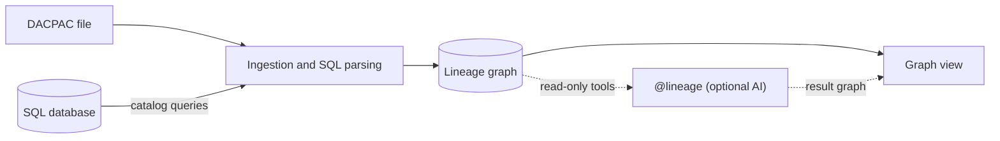

# Architecture

How Data Lineage Viz turns SQL metadata into a lineage graph, and how the optional `@lineage` chat helper builds on it. Build and test steps are in the [Developer Guide](DEVELOPER_GUIDE.md).

## Overview

The core is a deterministic lineage engine and a graph view. Search, tracing, path finding, analysis and table statistics all work without AI. `@lineage` is an optional chat helper on top of the loaded graph.

## Lineage engine

**Ingestion.** A DACPAC is read locally. A live database is read with the catalog (DMV) queries in [`DMV_QUERIES.md`](DMV_QUERIES.md): first a schema preview, then objects, columns, constraints and dependencies for the schemas you select. Both paths produce the same model.

**Edges.** Edges come from two sources combined. The catalog or DACPAC lists which objects reference which, but not whether a procedure reads, writes or calls them. Configurable regex [parse rules](PARSE_RULES.md) read the SQL bodies to supply that direction: stored procedures get their reads, writes and calls from the rules, and views and functions use them to add references the metadata misses. A catalog dependency no rule captured is still drawn, with a default direction.

**Graph.** The result is one directed, object-level graph: which object reads, writes or calls which, not which column feeds which. Tracing, path finding and pattern analysis run on it locally, and a React webview draws it.

**Table statistics.** Profiling is separate from lineage. It runs only when you request it, on its own connection; see [`PROFILING_PATTERNS.md`](PROFILING_PATTERNS.md).

## Data access

**DACPAC.** Read locally; no connection is made.

**Database import.** Runs the read-only catalog queries in [`DMV_QUERIES.md`](DMV_QUERIES.md) when you start an import.

**Table statistics.** Runs row-count and aggregate queries on a table when you request them. Setting: `dataLineageViz.tableStatistics.enabled`.

**`@lineage`.** Sends the question, recent chat and the SQL or metadata it reads to the chat model selected in VS Code. Setting: `dataLineageViz.ai.enabled`.

The extension connects only to the database, with SQL login or Microsoft Entra ID; Entra ID sign-in also contacts Microsoft. Logs are local; AI trace files are written only when enabled.

## Code map

| Directory | Contents |
|---|---|
| `src/engine/` | Ingestion, SQL parsing, graph building, tracing, profiling, database connections |
| `src/bridge/` | Host handlers for webview messages |
| `src/components/`, `src/hooks/` | React graph view |
| `src/ai/` | Optional `@lineage` chat participant, its tools and prompts |
| `assets/` | Built-in parse rules, DMV queries, output templates, demo DACPAC |

## Optional AI: `@lineage`

`@lineage` runs in VS Code chat with the AI chat model you picked, which can be a local one such as Ollama through Copilot bring-your-own-key (BYOK). It reads only the loaded graph through read-only tools; it cannot connect to a database or run SQL. Its result is a highlighted subgraph with a written explanation.

A small question is answered directly in chat. A larger one becomes an exploration plan that you approve, change or cancel; the approved plan is then walked object by object, and the findings are written up as the answer and a result graph.

### Exploration

Each step is a **hop**: the AI reads one object's SQL, records what it does, and notes which neighbors to skip or check. The engine decides the order, keeps the run inside the approved scope, visits every object once, and rejects invalid answers. If a hop cannot produce a valid answer, the run stops with an error naming the object.

Exploration runs in one of two modes, chosen when you approve the plan:

- **BB** (object lineage) follows whole objects: which procedures and views feed a table, and what they do.
- **CT** (column trace) is an AI-only option on top of BB: the AI reads each object's SQL and reports which source columns feed each named column (copied, computed, aggregated, or only used to join or filter). The engine has no column lineage of its own; it only checks that every column the AI names exists. Check column links against the SQL.

### Large graphs and memory

The graph is never sent to the AI whole. A chat answer reads at most `dataLineageViz.ai.discoveryNodeCap` objects within `dataLineageViz.ai.discoveryTokenBudget` tokens; an exploration is limited to `dataLineageViz.ai.maxRounds` hops.

Each hop uses sliding memory: the question and approved scope, the current object, its neighbors' columns, and short summaries of the last three hops. After each hop the conversation restarts from that summary, so the prompt stays the same size however many objects a run visits. The findings are kept by the engine and read once at the end to write the answer.

## Design boundaries

- `src/engine/` never imports `src/components/` or `src/ai/`.
- `src/ai/` reads the loaded graph only and imports no database or network code.
- Tool calls and webview messages are schema-checked.
- Other VS Code agents can call the read-only lineage tools.
