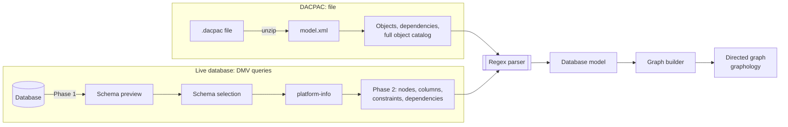
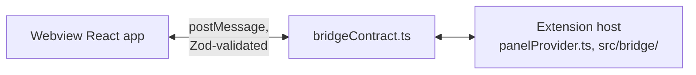

# Developer guide

How to build, run and change this extension in a clone. Concepts: [`ARCHITECTURE.md`](ARCHITECTURE.md). User-replaceable YAML: [`PARSE_RULES.md`](PARSE_RULES.md), [`DMV_QUERIES.md`](DMV_QUERIES.md), [`AI_PROMPTS.md`](AI_PROMPTS.md). Coding standards: [`../CONTRIBUTING.md`](../CONTRIBUTING.md).

## Toolchain

| Tool | Requirement | Declared in |
|---|---|---|
| Node.js | 22.x ≥22.22.2, 24.x ≥24.15, or ≥26 | `engines.node` in [`package.json`](../package.json) |
| npm | `>=10` | `engines.npm` |
| VS Code | `^1.101.0` | `engines.vscode` |

Run `npm ci` after cloning, after any pull that changes `package.json` or `package-lock.json`, and to replace a stale or copied `node_modules`.

LangChain's transitive `langsmith` dependency is replaced by an inert local stub through npm `overrides`, so the extension never contacts LangSmith. If `node_modules` was copied, or the bundle fails with `Could not resolve "langsmith"`, run [`scripts/repair-langsmith-stub.mjs`](../scripts/repair-langsmith-stub.mjs) by hand.

## Repository layout

| Path | Contents |
|---|---|
| [`src/engine/`](../src/engine/) | DACPAC and DMV ingestion, regex SQL parser, model and graph builder, tracing, profiling, display-mode policy, node decoration, column-trace projection. Engine-owned node-data types live here; the webview imports them. |
| [`src/engine/db/`](../src/engine/db/) | Built-in `tedious` connection provider, saved connections, Entra ID sign-in, connection errors. |
| [`src/engine/shared/`](../src/engine/shared/) | Zod message contract between host and webview (`bridgeContract.ts`), SQL identifier and metadata helpers. |
| [`src/bridge/`](../src/bridge/) | Host handlers for webview messages. |
| [`src/components/`](../src/components/), [`src/hooks/`](../src/hooks/), [`src/contexts/`](../src/contexts/), [`src/detail/`](../src/detail/) | React webview: graph canvas (React Flow), filters, detail panel, AI report column. |
| [`src/ai/`](../src/ai/) | `@lineage` chat participant, navigation engine, tools, prompts, session state. |
| [`src/utils/`](../src/utils/) | Logging, notifications, redaction, layout worker, theming helpers. |
| [`assets/`](../assets/) | `defaultParseRules.yaml`, `dmvQueries.yaml`, `aiOutputTemplates.yaml`, demo `.dacpac`. |
| [`tests/`](../tests/) | `unit/` Vitest suites, `cases/` shared case catalog, `integration/` VS Code host lanes, `scale/`, `harness/`, `fixtures/`, `stubs/`, `tools/`. |

## Build and run

```bash
git clone https://github.com/ChrisDevRepo/vscode_data_lineage.git
cd vscode_data_lineage
npm ci
npm run typecheck             # type-check only
npm run build                 # esbuild extension + Vite webview
npm run package               # package with the pinned local @vscode/vsce
```

Press <kbd>F5</kbd> to build both bundles and launch the Extension Development Host. **Run Extension (Watch)** builds the webview once through its prerequisite task, then watches the extension bundle; run `npm run build:webview` again after React or CSS changes.

### Packaging

- `@vscode/vsce` is an exact-version development dependency.
- Packaging uses `--no-dependencies`: every production dependency is bundled into `out/` and `dist/`, and `vsce`'s `npm ls` pass misreports npm `overrides` as invalid. Pass it to a direct `vsce package` or `vsce publish` too.
- [`THIRD_PARTY_NOTICES.md`](../THIRD_PARTY_NOTICES.md) must match the bundles; the gate checks it. After a dependency change run `npm run build`, then `node scripts/generate-third-party-notices.mjs`.
- `vsce` never reads `.gitignore`; exclude files from the VSIX in [`.vscodeignore`](../.vscodeignore).

## Ingestion: two paths, one model



Both paths produce a `DatabaseModel`, through the same preprocessing, parse rules, normalisation and edge-direction logic; the parser does not know the source.

A DACPAC is read locally from its `model.xml`; a live database is read with the queries in [`DMV_QUERIES.md`](DMV_QUERIES.md#query-execution), through a built-in `tedious` connection that uses `ReadOnly` application intent, with passwords in VS Code `SecretStorage`. A change to SQL sent to a live database updates `DMV_QUERIES.md` (or `PROFILING_PATTERNS.md`) in the same change.

## SQL parsing

Extraction regexes are in [`assets/defaultParseRules.yaml`](../assets/defaultParseRules.yaml) and run in [`src/engine/sqlBodyParser.ts`](../src/engine/sqlBodyParser.ts); the pipeline is described in [`PARSE_RULES.md`](PARSE_RULES.md#how-sql-is-read).

## Host/webview boundary



Every message crossing the boundary is parsed with the Zod schemas in [`src/engine/shared/bridgeContract.ts`](../src/engine/shared/bridgeContract.ts) before a handler sees it. Main-panel routing starts in [`src/panelProvider.ts`](../src/panelProvider.ts); handlers are in [`src/bridge/`](../src/bridge/).

### Layering

- `src/engine/` never imports `src/components/` (a gate step checks this) or uses the browser `window` global.
- `src/ai/` reaches the engine through `src/engine/shared/`; older imports are listed in [`tests/unit/ai-core/rule-gates.test.ts`](../tests/unit/ai-core/rule-gates.test.ts) and the list may only shrink.
- Log through [`src/utils/log.ts`](../src/utils/log.ts); user-facing errors go through [`src/utils/notifications.ts`](../src/utils/notifications.ts), which removes credentials.

## AI runtime

`@lineage` always uses the chat model selected in VS Code (`ChatRequest.model`); the extension has no provider, endpoint, credential or model-picker setting. AI code receives the loaded lineage model only; it cannot connect to a database, run SQL, re-import or start profiling. The code lives in [`src/ai/`](../src/ai/) (participant, agent graph, navigation engine, prompts, tools); the model writes findings and the engine validates them and assembles the rendered answer ([architecture overview](ARCHITECTURE.md)). Validation does not prove that the model interpreted the SQL correctly. After changing the tool catalog, run `npm run generate:tool-manifest`.

## Testing

Tiers, lanes and optional configuration: [`testing/README.md`](testing/README.md). Machine needs, including headless Linux: [`testing/ENVIRONMENTS.md`](testing/ENVIRONMENTS.md).

Run `npm run gate` before a push; it needs no database, model provider or display. The full command list is in [`testing/README.md`](testing/README.md#default-checks).

For AI changes, also check answers against the loaded SQL and graph.

## Diagnostics

**Data Lineage: Enable AI Trace Logging for This Session** writes NDJSON under the workspace `tmp/lm-trace/` until the extension host restarts; it needs an open workspace folder. Trace files contain schema, table and column names, prompts, responses, tool payloads and SQL: never commit them and review them before sharing.

Headless test runs export traces as described in [`testing/README.md`](testing/README.md#live-model-and-database-settings); the extension in VS Code never uploads traces.

**Data Lineage: Dump AI State Machine** writes the current exploration state to `tmp/sm-dumps/`. It needs an open workspace and an active hop-by-hop exploration.
