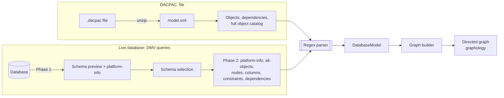

# Developer Guide

How to build, run and change this extension in a clone. Concepts: [`ARCHITECTURE.md`](ARCHITECTURE.md). User-replaceable YAML: [`PARSE_RULES.md`](PARSE_RULES.md), [`DMV_QUERIES.md`](DMV_QUERIES.md), [`AI_PROMPTS.md`](AI_PROMPTS.md). How to propose a change: [`../CONTRIBUTING.md`](../CONTRIBUTING.md).

## Toolchain

| Tool | Requirement | Declared in |
|---|---|---|
| Node.js | `>=20` | `engines.node` in [`package.json`](../package.json) |
| npm | `>=10` | `engines.npm` |
| VS Code | `^1.101.0` | `engines.vscode` |

Run `npm ci` after cloning, after any pull that changes `package.json` or `package-lock.json`, and to replace a stale or copied `node_modules`.

LangChain's transitive `langsmith` dependency is replaced by an inert local stub through npm `overrides`, so the extension never contacts LangSmith. The `postinstall` script [`scripts/repair-langsmith-stub.mjs`](../scripts/repair-langsmith-stub.mjs) copies the stub into place; run it by hand if `node_modules` was copied or the bundle fails with `Could not resolve "langsmith"`.

## Repository layout

| Path | Contents |
|---|---|
| [`src/engine/`](../src/engine/) | DACPAC and DMV ingestion, regex SQL parser, model and graph builders, tracing, profiling, connection manager. |
| [`src/engine/db/`](../src/engine/db/) | Built-in `tedious` connection provider, saved connections, Entra ID sign-in, connection errors. |
| [`src/engine/shared/`](../src/engine/shared/) | Zod message contract between host and webview (`bridgeContract.ts`), shared types, SQL identifier and metadata helpers. |
| [`src/bridge/`](../src/bridge/) | Host handlers for webview messages. |
| `src/components/`, `src/hooks/`, `src/contexts/`, `src/detail/` | React webview: graph canvas (React Flow), filters, detail panel, AI report column. |
| [`src/ai/`](../src/ai/) | `@lineage` participant, phase graph, navigation engine, tools, prompts, session state. |
| [`src/utils/`](../src/utils/) | Logging, notifications, redaction, layout worker. |
| [`assets/`](../assets/) | `defaultParseRules.yaml`, `dmvQueries.yaml`, `aiOutputTemplates.yaml`, demo `.dacpac`. |
| [`tests/`](../tests/) | `unit/` Vitest suites, `integration/` VS Code host lanes, `fixtures/`, `stubs/`, `harness/`, `scale/`, `tools/` (gate and runners). |

## Build and run

```bash
git clone https://github.com/ChrisDevRepo/vscode_data_lineage.git
cd vscode_data_lineage
npm ci
npm run typecheck             # type-check only; there is no lint script
npm run build                 # esbuild extension + Vite webview
npm run gate                  # every deterministic check
npm run package               # VSIX with the pinned local @vscode/vsce
```

Press <kbd>F5</kbd> (**Run Extension**) to build both bundles and launch the Extension Development Host. **Run Extension (Watch)** builds the webview once, then watches the extension bundle; run `npm run build:webview` after React or CSS changes.

### Packaging

- `@vscode/vsce` is an exact-version development dependency. Packaging uses `--no-dependencies`: every production dependency is bundled into `out/` and `dist/`, and `vsce`'s `npm ls` pass misreports npm `overrides` as invalid. Pass it to a direct `vsce package` or `vsce publish` too.
- [`THIRD_PARTY_NOTICES.md`](../THIRD_PARTY_NOTICES.md) must match the bundles; the gate checks it. After a dependency change run `npm run build`, then `node scripts/generate-third-party-notices.mjs`.
- `vsce` never reads `.gitignore`. Excluding a file from the VSIX needs an entry in [`.gitignore`](../.gitignore), [`.vscodeignore`](../.vscodeignore) and the forbidden list in [`tests/tools/assert-package-contents.mjs`](../tests/tools/assert-package-contents.mjs).

## Ingestion: two paths, one model



Both paths produce a `DatabaseModel` through the same preprocessing, parse rules, normalization and edge-direction logic; the parser does not know the source. Each extractor stamps `DatabaseModel.source` (`'dacpac'` or `'database'`).

- **DACPAC:** [`dacpacExtractor.ts`](../src/engine/dacpacExtractor.ts) reads `model.xml` from the ZIP, derives the platform label from its DSP and keeps the lightweight object catalog.
- **Live database:** [`dmvExtractor.ts`](../src/engine/dmvExtractor.ts) and [`connectionManager.ts`](../src/engine/connectionManager.ts) run the queries in [`assets/dmvQueries.yaml`](../assets/dmvQueries.yaml) ([`DMV_QUERIES.md`](DMV_QUERIES.md#query-execution)). Platform detection finishes before the model is built: `platform-info`, or an explicit `Unknown database platform`. A change to SQL sent to a live database updates `DMV_QUERIES.md` (or `PROFILING_PATTERNS.md`) in the same change.
- **Connections:** [`src/engine/db/`](../src/engine/db/). `connectDatabase` returns a `DbSession` from the built-in `tedious` provider with `ReadOnly` application intent; saved connections live in `dataLineageViz.database.connections` and passwords in `SecretStorage`. Connection failures are presented only by `connectionErrors.ts`.
- **Persistence:** [`projectStore.ts`](../src/engine/projectStore.ts). On read, unknown fields are dropped and a project is discarded only when a required field is missing or mistyped. A change to `Project` or `FilterProfile` needs a migration in `migrateProjectStore()`. `StoredConnectionInfoSchema` stays `.strict()` so credentials never enter the store.
- **AI run records:** [`src/ai/session/runStore.ts`](../src/ai/session/runStore.ts) keeps one record per AI-authored bookmark in `globalState` under `dataLineageViz.aiRun.<bookmarkId>`; deleting the bookmark or project clears it, and a record of another `schemaVersion` reads as absent.

## SQL parsing

Extraction regexes are in [`assets/defaultParseRules.yaml`](../assets/defaultParseRules.yaml). [`src/engine/sqlBodyParser.ts`](../src/engine/sqlBodyParser.ts) owns the built-in cleansing passes, rule execution and dependency resolution; the pipeline and its limits are in [`PARSE_RULES.md`](PARSE_RULES.md#how-sql-is-read). Run `npm run test:parser` after a change.

## Host/webview boundary

Every message crossing the boundary is parsed with the Zod schemas in [`src/engine/shared/bridgeContract.ts`](../src/engine/shared/bridgeContract.ts) before a handler sees it. Main-panel routing starts in [`src/panelProvider.ts`](../src/panelProvider.ts); handlers are in [`src/bridge/`](../src/bridge/).

- `src/engine/` never imports `src/components/` (a gate step checks this) and never names the browser `window`.
- Log through [`src/utils/log.ts`](../src/utils/log.ts). User-facing errors go through [`src/utils/notifications.ts`](../src/utils/notifications.ts), which logs the detail and removes credentials. Database, schema and object names belong in debug lines; info lines carry counts and timing.

## AI runtime

`@lineage` uses the chat model selected in VS Code (`ChatRequest.model`) and receives the loaded lineage model only; it cannot connect to a database, run SQL, re-import or start profiling. Code: [`src/ai/`](../src/ai/) (participant, phase graph, navigation engine, tools, prompts); see the [architecture overview](ARCHITECTURE.md#optional-ai-lineage). The model writes findings and the engine validates them; validation does not prove the model read the SQL correctly. After changing the tool catalog, run `npm run generate:tool-manifest`.

## Testing

Tiers, lanes and optional configuration: [`testing/README.md`](testing/README.md). Machine needs, including headless Linux: [`testing/ENVIRONMENTS.md`](testing/ENVIRONMENTS.md). Run `npm run gate` before a push; it needs no database, model provider or display. For AI changes, also check answers against the loaded SQL and graph.

## Diagnostics

**Data Lineage: Enable AI Trace Logging for This Session** writes NDJSON under the workspace `tmp/lm-trace/` until the extension host restarts; it needs an open workspace folder. **Data Lineage: Dump AI State Machine** writes the exploration state to `tmp/sm-dumps/` (needs an active hop-by-hop exploration). Both can contain schema names, SQL, prompts and responses: never commit them and review them before sharing. The extension never uploads them.
