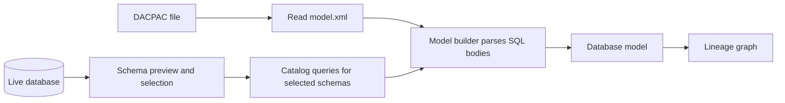

# Developer guide

How to build and run the extension and where its code lives. Design, terms and contracts are in [`ARCHITECTURE.md`](ARCHITECTURE.md); build-from-source steps are in [`../CONTRIBUTING.md`](../CONTRIBUTING.md). The user-replaceable YAML files are documented in [`PARSE_RULES.md`](PARSE_RULES.md), [`DMV_QUERIES.md`](DMV_QUERIES.md) and [`AI_PROMPTS.md`](AI_PROMPTS.md).

## Toolchain

Node.js `>=20`, npm `>=10` and VS Code `^1.101.0` (see `engines` in [`package.json`](../package.json)). Run `npm ci` after cloning and after any pull that changes `package.json` or `package-lock.json`.

LangChain's `langsmith` dependency is replaced by a local stub through npm `overrides`. If the bundle fails with `Could not resolve "langsmith"` (for example after copying `node_modules`), run `scripts/repair-langsmith-stub.mjs`; `postinstall` normally does this.

## Build and run

```bash
git clone https://github.com/ChrisDevRepo/vscode_data_lineage.git
cd vscode_data_lineage
npm ci
npm run typecheck             # type-check only
npm run build                 # esbuild extension + Vite webview
npm run package               # package with the pinned local @vscode/vsce
```

Press <kbd>F5</kbd> to build both bundles and launch the Extension Development Host. **Run Extension (Watch)** watches only the extension bundle; run `npm run build:webview` after React or CSS changes.

Packaging uses `--no-dependencies` because all production dependencies are bundled; pass it to a direct `vsce package` or `vsce publish` too. [`THIRD_PARTY_NOTICES.md`](../THIRD_PARTY_NOTICES.md) must match the bundles (the gate checks it): run `npm run build`, then `node scripts/generate-third-party-notices.mjs`. To exclude a file from the VSIX, edit [`.gitignore`](../.gitignore), [`.vscodeignore`](../.vscodeignore) and the forbidden list in `tests/tools/assert-package-contents.mjs`.

## Two ingestion paths, one model



A `.dacpac` and a live database produce the same database model through the same parse rules; the model's `source` field (`'dacpac'` or `'database'`) records which. The DMV extractor runs `assets/dmvQueries.yaml` as described in [`DMV_QUERIES.md`](DMV_QUERIES.md#query-execution); a change to SQL sent to a live database updates that page in the same commit. SQL parse regexes are in `assets/defaultParseRules.yaml`, and the passes are listed in [`PARSE_RULES.md`](PARSE_RULES.md#how-sql-is-read).

Saved projects are read tolerantly and written through the strict schemas in `src/engine/shared/bridgeContract.ts`, which keep credentials out of the store. A change to the saved project or filter-profile shape needs a reviewed compatibility path.

## Database connection providers

The built-in provider uses `tedious`, one session per operation, cancelled on the wire when `dataLineageViz.dmvQueryTimeout` elapses. Saved connections live in `dataLineageViz.database.connections` without passwords; passwords live in VS Code `SecretStorage`. Entra ID connections sign in through `@microsoft/vscode-azext-azureauth`. Connection errors show `<connection name>: <driver text>` with secrets redacted; transient Azure errors are retried when connecting.

## Host/webview boundary

Every host/webview message is validated with the Zod schemas in `src/engine/shared/bridgeContract.ts`. Main-panel messages are parsed in `src/panelProvider.ts`; handlers for both panels are in `src/bridge/`. User-facing errors go through the notification helpers in `src/utils/`, which log the detail and redact credentials.

Layering rules:

- `src/engine/` never imports `src/components/` (a gate step checks this) and never uses the browser `window` global.
- `src/ai/` reaches the engine only through `src/engine/shared/`.

## AI runtime

The `@lineage` participant and tool catalog are described in [`ARCHITECTURE.md`](ARCHITECTURE.md); prompts and templates in [`AI_PROMPTS.md`](AI_PROMPTS.md). After changing the tool catalog, run `npm run generate:tool-manifest`. During development `@lineage` was tested with several models, such as Claude, ChatGPT, DeepSeek Flash, Gemini Flash, GLM Flash and Qwen, through providers such as Azure OpenAI, Fireworks, OpenRouter and local OpenAI-compatible servers; this is not a list of supported models.

## Testing

Test tiers, commands and VS Code host lanes are in [`testing/README.md`](testing/README.md); machine needs in [`testing/ENVIRONMENTS.md`](testing/ENVIRONMENTS.md). Run `npm run gate` before a push; it needs no database, model provider or display.

## Diagnostics

**Data Lineage: Enable AI Trace Logging for This Session** writes NDJSON under the workspace `tmp/lm-trace/` until the extension host restarts; it needs an open workspace folder. Trace files contain schema, table and column names, prompts, responses, tool payloads and SQL: never commit them and review them before sharing. To analyze one, see [`.agents/skills/trace-debug/SKILL.md`](../.agents/skills/trace-debug/SKILL.md).

For span-level debugging, the headless test runner can also export a run to Langfuse: set `LANGFUSE_BASE_URL`, `LANGFUSE_PUBLIC_KEY` and `LANGFUSE_SECRET_KEY` (see [`.env.example`](../.env.example)) and run `npm run test:ai:headless -- --langfuse`. The extension in VS Code does not export to Langfuse.

**Data Lineage: Dump AI State Machine** writes the current exploration state to `tmp/sm-dumps/` during an active hop-by-hop exploration.

## Where to change it

- SQL parse rules: `assets/defaultParseRules.yaml` and the SQL body parser in `src/engine/`; run `npm run test:parser`.
- Live-database import: `assets/dmvQueries.yaml`, the DMV extractor in `src/engine/`, and connections in `src/engine/db/`.
- Table statistics SQL: the profiling engine in `src/engine/`; see [`PROFILING_PATTERNS.md`](PROFILING_PATTERNS.md).
- Saved projects: the project store in `src/engine/` and the schemas in `src/engine/shared/`.
- Webview: `src/components/` and `src/hooks/`; messages in `src/engine/shared/`.
- AI prompts and output templates: `src/ai/prompting/` and `assets/aiOutputTemplates.yaml`.
- AI tools, phase policy and process guards: `src/ai/tools/`, `src/ai/session/` and `src/ai/interaction/`.
