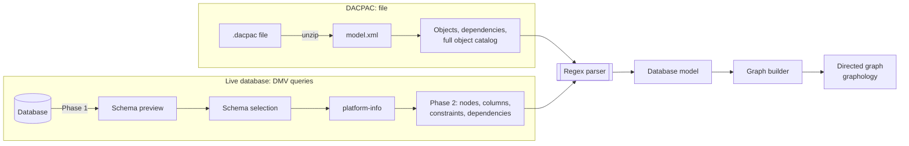
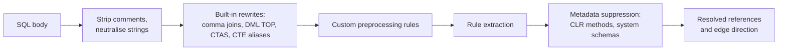
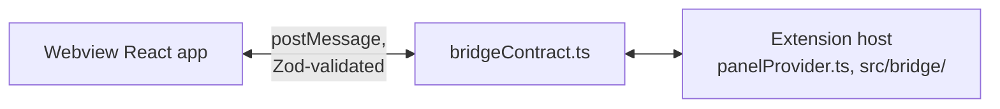

# Developer guide

How to build, run and change this extension in a clone. Concepts: [`ARCHITECTURE.md`](ARCHITECTURE.md). User-replaceable YAML: [`PARSE_RULES.md`](PARSE_RULES.md), [`DMV_QUERIES.md`](DMV_QUERIES.md), [`AI_PROMPTS.md`](AI_PROMPTS.md). Coding standards: [`../CONTRIBUTING.md`](../CONTRIBUTING.md).

## Toolchain

| Tool | Requirement | Declared in |
|---|---|---|
| Node.js | `>=20` | `engines.node` in [`package.json`](../package.json) |
| npm | `>=10` | `engines.npm` |
| VS Code | `^1.101.0` | `engines.vscode` |

Run `npm ci` after cloning, after any pull that changes `package.json` or `package-lock.json`, and to replace a stale or copied `node_modules`.

LangChain's transitive `langsmith` dependency is replaced by an inert local stub through npm `overrides`. Some npm 10 releases leave `node_modules/langsmith` as a dangling symlink; `postinstall` runs [`scripts/repair-langsmith-stub.mjs`](../scripts/repair-langsmith-stub.mjs) to copy the stub into place. Run it by hand if `node_modules` was copied, or if the bundle fails with `Could not resolve "langsmith"`. Runtime guards reject enabled LangSmith/LangChain tracing, and the gate checks that the real LangSmith client is not bundled.

## Repository layout

| Path | Contents |
|---|---|
| [`src/engine/`](../src/engine/) | DACPAC and DMV ingestion, regex SQL parser, model and graph builder, tracing, profiling, display-mode policy, node decoration, column-trace projection. Engine-owned node-data types live here; the webview imports them. |
| [`src/engine/db/`](../src/engine/db/) | Built-in `tedious` connection provider, saved connections, Entra ID sign-in, connection errors. |
| [`src/engine/shared/`](../src/engine/shared/) | Zod message contract between host and webview (`bridgeContract.ts`), SQL identifier and metadata helpers. |
| [`src/bridge/`](../src/bridge/) | Host handlers for webview messages. |
| [`src/components/`](../src/components/), [`src/hooks/`](../src/hooks/) | React webview: graph canvas (React Flow), filters, detail panel, AI report column. |
| [`src/ai/`](../src/ai/) | `@lineage` chat participant, navigation engine, tools, prompts, session state. |
| [`src/utils/`](../src/utils/) | Logging, notifications, redaction, layout worker, theming helpers. |
| [`assets/`](../assets/) | `defaultParseRules.yaml`, `dmvQueries.yaml`, `aiOutputTemplates.yaml`, demo `.dacpac`. |
| [`tests/`](../tests/) | `unit/` Vitest suites, `cases/` shared case catalog, `integration/` VS Code host lanes, `harness/`, `fixtures/`, `stubs/`, `tools/`. |

## Build and run

```bash
git clone https://github.com/ChrisDevRepo/vscode_data_lineage.git
cd vscode_data_lineage
npm ci
npm run typecheck             # type-check only
npm run build                 # esbuild extension + Vite webview
npm run package               # package with the pinned local @vscode/vsce
```

Press <kbd>F5</kbd> to build both bundles and launch the Extension Development Host. **Run Extension (Watch)** builds the webview once through its prerequisite task, then watches the extension bundle; run `npm run build:webview` again after React or CSS changes.

### Packaging

- `@vscode/vsce` is an exact-version development dependency.
- Packaging uses `--no-dependencies`: every production dependency is bundled into `out/` and `dist/`, and `vsce`'s `npm ls` pass misreports npm `overrides` as invalid. Pass it to a direct `vsce package` or `vsce publish` too.
- [`THIRD_PARTY_NOTICES.md`](../THIRD_PARTY_NOTICES.md) must match the bundles; the gate checks it. After a dependency change run `npm run build`, then `node scripts/generate-third-party-notices.mjs`.
- `vsce` never reads `.gitignore`. Excluding a file from the VSIX takes three edits: [`.gitignore`](../.gitignore), [`.vscodeignore`](../.vscodeignore) and the forbidden list in [`tests/tools/assert-package-contents.mjs`](../tests/tools/assert-package-contents.mjs).

## Ingestion: two paths, one model



Both paths produce a `DatabaseModel`, through the same preprocessing, parse rules, normalisation and edge-direction logic; the parser does not know the source. Each extractor stamps `DatabaseModel.source` (`'dacpac'` or `'database'`). Read that field for provenance; `dbPlatform` is no proxy, because a DACPAC derives a platform label from its DSP just as a live import derives one from the server.

**DACPAC** ([`src/engine/dacpacExtractor.ts`](../src/engine/dacpacExtractor.ts)). Reads `model.xml` from the ZIP, derives `dbPlatform` from the DSP and keeps the full lightweight object catalog. Unknown DSP text is kept as is.

**Live database** ([`src/engine/dmvExtractor.ts`](../src/engine/dmvExtractor.ts), [`src/engine/connectionManager.ts`](../src/engine/connectionManager.ts)). Runs the queries in [`assets/dmvQueries.yaml`](../assets/dmvQueries.yaml), described in [`DMV_QUERIES.md`](DMV_QUERIES.md#query-execution). Platform detection finishes before the selected-schema model is built; an unusable `platform-info` result records `Unknown database platform` without failing the import. Each import reads the YAML again. A change to SQL sent to a live database updates `DMV_QUERIES.md` (or `PROFILING_PATTERNS.md`) in the same commit.

**Connections** ([`src/engine/db/`](../src/engine/db/)). `connectDatabase` returns a `DbSession` from the built-in `tedious` provider: one session per operation, `ReadOnly` application intent, encryption on by default, cancelled on the wire when `dataLineageViz.dmvQueryTimeout` elapses, and connect-time retries on transient Azure errors. Saved connections live in `dataLineageViz.database.connections` without passwords; passwords live in VS Code `SecretStorage`. Entra ID connections sign in through `@microsoft/vscode-azext-azureauth`. Connection errors are presented only by `connectionErrors.ts`, as `<connection name>: <driver text>` with secrets redacted. Tests: [`tests/unit/engine/db/`](../tests/unit/engine/db/).

**Saved projects** ([`src/engine/projectStore.ts`](../src/engine/projectStore.ts)). On read, unknown fields are dropped; a project is discarded only when a required field is missing or has the wrong type. On write, `StoredConnectionInfoSchema` in `bridgeContract.ts` stays `.strict()`, so undeclared connection fields, credentials included, never enter the store. A change to `Project` or `FilterProfile` needs a migration in `migrateProjectStore()`.

**AI run records** ([`src/ai/session/runStore.ts`](../src/ai/session/runStore.ts)). One record per AI-authored bookmark, in `globalState` under `dataLineageViz.aiRun.<bookmarkId>`. A bookmark save writes it only when the view is AI-authored and its run matches the captured presentation; a failed write logs a warning and the bookmark still saves. `delete-view` and `delete-project` clear it, and a new route that removes a saved view must clear it too. A record of another `schemaVersion` or with an invalid snapshot reads as absent.

**Data from older builds.** A user's saved connections, projects and bookmarks keep opening after an upgrade. Each supported older shape has one test; removing a path removes its test and adds a CHANGELOG `Removed` entry.

| Older shape | Behaviour | Test |
|---|---|---|
| Workspace-state keys from builds before the project store | Moved into a project once; the old keys are then cleared | [`legacyMigration.test.ts`](../tests/unit/engine/legacyMigration.test.ts) |
| Project without `connectionId` (mssql-extension era) | Matched by server, port, sign-in type and user; otherwise a pre-filled picker once, then direct reconnect | [`connections.test.ts`](../tests/unit/engine/db/connections.test.ts) |
| Connection fields an older build wrote (string `port`/`encrypt`, Integrated auth, extra keys) | Read; unknown keys dropped | [`projectStore.test.ts`](../tests/unit/engine/projectStore.test.ts), [`storedConnectionIntegrity.test.ts`](../tests/unit/engine/storedConnectionIntegrity.test.ts) |
| 1.0.3-shaped saved views | Load and re-save unchanged | [`projectStore.test.ts`](../tests/unit/engine/projectStore.test.ts) |
| Node IDs in views and bookmarks saved without `nodeIdEncodingVersion` | Resolved when the reference has a unique owner in the current model | [`node-id-resolution.test.ts`](../tests/unit/engine/node-id-resolution.test.ts), [`external-file-stability.test.ts`](../tests/unit/engine/external-file-stability.test.ts), [`identifier-checkpoint-review.test.ts`](../tests/unit/ai-core/identifier-checkpoint-review.test.ts) |


## SQL parsing



Extraction regexes are in [`assets/defaultParseRules.yaml`](../assets/defaultParseRules.yaml). [`src/engine/sqlBodyParser.ts`](../src/engine/sqlBodyParser.ts) owns the built-in passes, rule execution and reference resolution; metadata suppression is in [`src/engine/shared/sqlMetadata.ts`](../src/engine/shared/sqlMetadata.ts). Rule reference and limits: [`PARSE_RULES.md`](PARSE_RULES.md).

## Host/webview boundary



Every message crossing the boundary is parsed with the Zod schemas in [`src/engine/shared/bridgeContract.ts`](../src/engine/shared/bridgeContract.ts) before a handler sees it. Main-panel routing starts in [`src/panelProvider.ts`](../src/panelProvider.ts); handlers are in [`src/bridge/`](../src/bridge/).

### Logging and notifications

- Log through [`src/utils/log.ts`](../src/utils/log.ts).
- User-facing errors and warnings go through `notifyError`, `notifyWarning` and `notifyInfo` in [`src/utils/notifications.ts`](../src/utils/notifications.ts). Each logs the full detail at the matching level before the toast, with credentials removed by `redactSecrets` ([`src/utils/redact.ts`](../src/utils/redact.ts)).
- Database, schema and object names belong in debug lines; info lines carry counts, modes and timing.
- Webview errors go through the bridge `'error'` message.

### Layering

- `src/engine/` never imports `src/components/`; a gate step checks this.
- `src/engine/` never uses the browser `window` global. A diagnostic from `graphBuilder.ts` goes through the `setGraphLogSink` callback that the webview installs at startup.
- `src/ai/` reaches the engine only through `src/engine/shared/`. Older imports are listed in [`tests/unit/ai-core/rule-gates.test.ts`](../tests/unit/ai-core/rule-gates.test.ts); the list may only shrink.

## AI runtime

`@lineage` always uses the chat model selected in VS Code (`ChatRequest.model`). The extension has no provider, endpoint, credential, fallback-model or model-picker setting. AI code receives the loaded lineage model only; it cannot connect to a database, run SQL, re-import or start profiling.

| Part | Location |
|---|---|
| Participant: requests, history, cancellation, progress, buttons | [`src/ai/participant/lineageParticipant.ts`](../src/ai/participant/lineageParticipant.ts) |
| Outer graph: phases, semantic retries, interrupts, synthesis | [`src/ai/agent/graph.ts`](../src/ai/agent/graph.ts) |
| Navigation engine: agenda, topology, gates, validation, termination | `NavigationEngine` in [`src/ai/sm/smBase.ts`](../src/ai/sm/smBase.ts) |
| Prompt builders | [`src/ai/prompting/`](../src/ai/prompting/); stage assembly in [`stagePrompts.ts`](../src/ai/agent/stagePrompts.ts), one-call planning in [`instructionPlan.ts`](../src/ai/agent/instructionPlan.ts) |
| Tool registry, phase policy, Zod dispatcher | [`src/ai/tools/`](../src/ai/tools/) |

The model writes findings and structured presentation fields. The engine validates structure and graph consistency, keeps the result graph connected to its origin, and assembles the rendered answer from the structured parts. Validation does not prove that the model interpreted the SQL correctly. After changing the tool catalog, run `npm run generate:tool-manifest`.

During development `@lineage` was tested with several models, such as Claude, ChatGPT, DeepSeek Flash, Gemini Flash, GLM Flash and Qwen, through providers such as Azure OpenAI, Fireworks, OpenRouter and local OpenAI-compatible servers; this is not a list of supported models.

## Testing

Tiers, lanes and optional configuration: [`testing/README.md`](testing/README.md). Machine needs, including headless Linux: [`testing/ENVIRONMENTS.md`](testing/ENVIRONMENTS.md).

| Command | Scope |
|---|---|
| `npm run gate` | Deterministic checks, coverage floors, builds and package checks. Needs no database, model provider or display. Run before a push. |
| `npm test` | Parser, lineage and deterministic AI contract suites. |
| `npm run test:parser` | Expected edges per SQL construct. |
| `npm run test:core` | Parser and deterministic lineage tests; supporting webview tests run in `npm run test:support`. |
| `npm run coverage:core` | Protected core coverage floors. |
| `npm run test:runtime` | Agent runtime and state machine with a stubbed VS Code API. |
| `npm run typecheck:tests` | Type-check the tests. |
| `npm run test:edh` | Smoke lanes in a real VS Code host. |

For AI changes, also check answers against the loaded SQL and graph.

## Diagnostics

**Data Lineage: Enable AI Trace Logging for This Session** writes NDJSON under the workspace `tmp/lm-trace/` until the extension host restarts; it needs an open workspace folder. Trace files contain schema, table and column names, prompts, responses, tool payloads and SQL: never commit them and review them before sharing. To analyse one, see [`.agents/skills/trace-debug/SKILL.md`](../.agents/skills/trace-debug/SKILL.md).

For span-level debugging, the headless test runner can export a run to Langfuse: set `LANGFUSE_BASE_URL`, `LANGFUSE_PUBLIC_KEY` and `LANGFUSE_SECRET_KEY` (see [`.env.example`](../.env.example)) and run `npm run test:ai:headless -- --langfuse`. The extension in VS Code does not export to Langfuse.

**Data Lineage: Dump AI State Machine** writes the current exploration state to `tmp/sm-dumps/`. It needs an open workspace and an active hop-by-hop exploration.

## Where to look first

| Changing | Read |
|---|---|
| SQL parse rules | [`PARSE_RULES.md`](PARSE_RULES.md), [`assets/defaultParseRules.yaml`](../assets/defaultParseRules.yaml), [`src/engine/sqlBodyParser.ts`](../src/engine/sqlBodyParser.ts). Run `npm run test:parser`. |
| Live-database import | [`DMV_QUERIES.md`](DMV_QUERIES.md), [`assets/dmvQueries.yaml`](../assets/dmvQueries.yaml), [`src/engine/dmvExtractor.ts`](../src/engine/dmvExtractor.ts), [`src/engine/db/`](../src/engine/db/). |
| Table statistics SQL | [`PROFILING_PATTERNS.md`](PROFILING_PATTERNS.md), [`src/engine/profilingEngine.ts`](../src/engine/profilingEngine.ts). |
| Saved projects | [`src/engine/projectStore.ts`](../src/engine/projectStore.ts), [`src/engine/shared/bridgeContract.ts`](../src/engine/shared/bridgeContract.ts). |
| Webview (React Flow, filters, themes) | [`src/panelProvider.ts`](../src/panelProvider.ts), [`src/engine/graphDisplayMode.ts`](../src/engine/graphDisplayMode.ts), [`src/engine/nodeDecoration.ts`](../src/engine/nodeDecoration.ts), [`src/engine/columnTraceView.ts`](../src/engine/columnTraceView.ts), [`src/engine/traceTree.ts`](../src/engine/traceTree.ts), [`src/components/`](../src/components/). |
| AI behaviour or prompts | [`AI_PROMPTS.md`](AI_PROMPTS.md), [`ARCHITECTURE.md`](ARCHITECTURE.md), [`src/ai/prompting/`](../src/ai/prompting/), [`assets/aiOutputTemplates.yaml`](../assets/aiOutputTemplates.yaml). |
| Tool surface, phase routing, process guards | [`src/ai/tools/toolProvider.ts`](../src/ai/tools/toolProvider.ts), [`src/ai/tools/toolPolicy.ts`](../src/ai/tools/toolPolicy.ts), [`src/ai/session/sessionPhase.ts`](../src/ai/session/sessionPhase.ts), [`src/ai/interaction/rules/`](../src/ai/interaction/rules/). |
