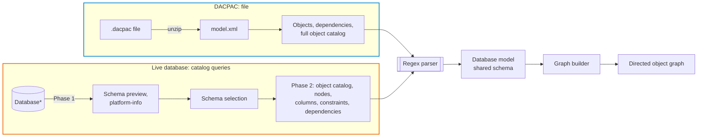
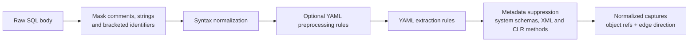
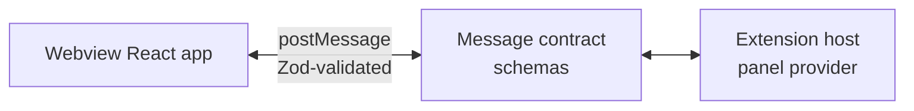

# Developer Guide

This guide takes you from a fresh clone to a running extension, a green test
run and a first change. Concepts are in [`ARCHITECTURE.md`](ARCHITECTURE.md).
Files you can edit without touching TypeScript:
[`PARSE_RULES.md`](PARSE_RULES.md), [`DMV_QUERIES.md`](DMV_QUERIES.md) and
[`AI_PROMPTS.md`](AI_PROMPTS.md). Contribution rules:
[`../CONTRIBUTING.md`](../CONTRIBUTING.md).

## Prerequisites

| Tool | Requirement | Declared in |
|------|-------------|-------------|
| [Git](https://git-scm.com/) | any recent version | |
| [Node.js](https://nodejs.org/) | `>=20` | `engines.node` in [`package.json`](../package.json) |
| npm | `>=10` | `engines.npm` in [`package.json`](../package.json) |
| [VS Code](https://code.visualstudio.com/) | `^1.101.0` | `engines.vscode` in [`package.json`](../package.json) |

The CI workflow runs on Node 22. No database, model provider or credentials
are needed to build, run or test. A VS Code chat model provider such as GitHub
Copilot is only needed to try `@lineage`.

## Clone and install

```bash
git clone https://github.com/ChrisDevRepo/vscode_data_lineage.git
cd vscode_data_lineage
npm ci
```

Use `npm ci`, not `npm install`: it installs exactly what `package-lock.json`
says. Run it again after any pull that changes `package.json` or
`package-lock.json`, and to replace a stale or copied `node_modules` folder.

LangChain's transitive `langsmith` dependency is replaced by an inert local
stub (`stubs/langsmith/`) through npm `overrides`. If the bundle fails with
`Could not resolve "langsmith"`, run `node scripts/repair-langsmith-stub.mjs`.
`postinstall` runs it as well.

## Build

| Command | What it does |
|---------|--------------|
| `npm run build` | Builds the extension and the webview. |
| `npm run build:ext` | esbuild bundles the extension host into `out/`. |
| `npm run build:webview` | Vite builds the React webview into `dist/`. |
| `npm run watch` | Rebuilds the extension bundle on every save. It does not rebuild the webview. |
| `npm run typecheck` | `tsc --noEmit` for `src/`. |

Run `npm run build:webview` after any React or CSS change.

## Run and debug the extension

1. Open the cloned folder in VS Code.
2. Press <kbd>F5</kbd> and pick a configuration from
   [`.vscode/launch.json`](../.vscode/launch.json).
   - **Run Extension** builds everything, then opens the Extension Development
     Host.
   - **Run Extension (Watch)** builds the webview once, then watches the
     extension bundle.
3. In the new window, run **Data Lineage: Open Demo**, or open a folder that
   contains a `.dacpac` and run **Data Lineage: Open Wizard**.

Set breakpoints in `src/` files; the build writes source maps next to the
bundles in `out/`. After a change to host code, restart the host
(<kbd>Ctrl+Shift+F5</kbd>, <kbd>Cmd+Shift+F5</kbd> on macOS). After a webview change, rebuild it and reload the
Extension Development Host window.

To debug the webview, run **Developer: Open Webview Developer Tools** in the
Extension Development Host.

## Project layout

| Path | Owns |
|------|------|
| [`src/extension.ts`](../src/extension.ts), [`src/extensionRuntime.ts`](../src/extensionRuntime.ts) | Activation. `extension.ts` loads the runtime bundle; `extensionRuntime.ts` sets up providers and commands. |
| [`src/commands.ts`](../src/commands.ts), [`src/sidebarProvider.ts`](../src/sidebarProvider.ts) | Command palette entries and the Quick Actions sidebar. |
| [`src/panelProvider.ts`](../src/panelProvider.ts) | Creates the lineage webview panel and routes its messages. |
| [`src/bridge/`](../src/bridge/) | Host-side message handlers for the webview and detail panel. |
| [`src/engine/`](../src/engine/) | DACPAC and live-database ingestion, regex SQL parser, graph builder, graph analysis, table statistics, connection manager, project store. |
| [`src/engine/graphBuilder.ts`](../src/engine/graphBuilder.ts) | Turns the database model into the directed graph the webview draws and analyses. |
| [`src/engine/shared/`](../src/engine/shared/) | Code shared by the host, the webview and `src/ai/`: the Zod message contract (`bridgeContract.ts`), model schemas, SQL helpers. |
| [`src/engine/db/`](../src/engine/db/) | Database sessions on the built-in `tedious` driver, sign-in and connection settings. |
| [`src/components/`](../src/components/), [`src/hooks/`](../src/hooks/), [`src/contexts/`](../src/contexts/) | The React webview: graph canvas (React Flow), toolbar, filters, side panels. |
| [`src/detail/`](../src/detail/) | The detail panel with the Monaco SQL viewer. |
| [`src/ai/`](../src/ai/) | The `@lineage` chat participant, agent graph, exploration state machine, tools, prompts and session memory. |
| [`src/export/`](../src/export/) | draw.io export. |
| [`src/utils/`](../src/utils/) | Logging, notifications, redaction, layout worker, helpers. |
| [`src/index.tsx`](../src/index.tsx), [`src/index.html`](../src/index.html) | Webview entry points. |
| [`assets/`](../assets/) | `defaultParseRules.yaml`, `dmvQueries.yaml`, `aiOutputTemplates.yaml` and the demo `.dacpac`. |
| [`tests/`](../tests/) | `unit/`, `integration/`, `scale/`, plus `fixtures/`, `harness/`, `stubs/` and `tools/`. |
| [`scripts/`](../scripts/) | Install and code-generation scripts. |

## How the parts fit together

The overview diagram and the role of each part are in
[`ARCHITECTURE.md`](ARCHITECTURE.md#overview).

## Two ingestion paths, one model



*The live lane supports SQL Server, Azure SQL, Fabric Data Warehouse, and
Synapse Dedicated SQL Pool. Query availability per platform:
[`DMV_QUERIES.md`](DMV_QUERIES.md).

Both paths produce the same database model. The parser does not know the
source: both use the same preprocessing, YAML extraction rules, normalization
and edge-direction logic. The model records its source (`dacpac` or
`database`). Read that field instead of guessing the source from the platform
label.

- **DACPAC:** [`src/engine/dacpacExtractor.ts`](../src/engine/dacpacExtractor.ts)
  reads `model.xml` from the ZIP archive, derives the platform label from its
  DSP, and keeps the lightweight catalog of all objects.
- **Live database:** [`src/engine/dmvExtractor.ts`](../src/engine/dmvExtractor.ts)
  runs the queries in [`assets/dmvQueries.yaml`](../assets/dmvQueries.yaml)
  through [`src/engine/connectionManager.ts`](../src/engine/connectionManager.ts).
  Platform detection finishes before the model for the selected schemas is
  built.
- **Connections:** [`src/engine/db/`](../src/engine/db/). The built-in
  `tedious` driver opens the connection. Saved connections live in the
  `dataLineageViz.database.connections` setting; passwords go to VS Code
  `SecretStorage`. See [`../SECURITY.md`](../SECURITY.md#connections).
- **Saved projects:** [`src/engine/projectStore.ts`](../src/engine/projectStore.ts).
  A change to the stored `Project` or `FilterProfile` shape must stay readable
  by `ProjectReadSchema` in `migrateProjectStore()`; records it cannot read are
  discarded with a warning.

## SQL parsing pipeline



Extraction regexes are in
[`assets/defaultParseRules.yaml`](../assets/defaultParseRules.yaml).
[`src/engine/sqlBodyParser.ts`](../src/engine/sqlBodyParser.ts) runs the
built-in passes, the rules and dependency resolution. Metadata suppression is
in [`src/engine/shared/sqlMetadata.ts`](../src/engine/shared/sqlMetadata.ts).

## Host and webview boundary



Messages in both directions are parsed with the Zod schemas in
[`src/engine/shared/bridgeContract.ts`](../src/engine/shared/bridgeContract.ts)
before a handler uses them. To add a message, add its schema there, then a
handler in [`src/bridge/`](../src/bridge/) (host side) or in the webview, and a
test. Webview errors are sent to the host as an `error` message and logged
there.

`src/engine/` must not import from `src/components/`; `npm run gate` checks
this. Engine code reaches the webview log through a callback the webview
entry point installs, not through `window`.

## The AI participant

What `@lineage` may and may not do:
[`ARCHITECTURE.md`](ARCHITECTURE.md#architectural-boundaries). Entry points:

| File or folder | Role |
|----------------|------|
| [`src/ai/participant/lineageParticipant.ts`](../src/ai/participant/lineageParticipant.ts) | Adapts VS Code chat requests, history, cancellation and buttons. |
| [`src/ai/agent/graph.ts`](../src/ai/agent/graph.ts) | Phases, retries and the final answer. |
| [`src/ai/sm/smBase.ts`](../src/ai/sm/smBase.ts) | Hop-by-hop exploration: which object is read next, validation, stop conditions. |
| [`src/ai/tools/`](../src/ai/tools/) | The tool registry and handlers. |
| [`src/ai/prompting/`](../src/ai/prompting/) | Prompt builders. Output templates are in `assets/aiOutputTemplates.yaml`. |
| [`src/ai/session/`](../src/ai/session/) | Per-chat memory and saved AI runs. |

Prompts and templates: [`AI_PROMPTS.md`](AI_PROMPTS.md).

Tool names, descriptions and input schemas are defined once in
`src/ai/tools/toolDefs.ts`. After you change them, run
`npm run generate:tool-manifest` to update the copy in
`package.json`; `npm run gate` fails if it is out of date.

## Test

Unit tests use [Vitest](https://vitest.dev/) with a stub for the VS Code API.
No VS Code window opens.

| Command | Covers |
|---------|--------|
| `npm test` | All unit tests in `tests/unit/`. |
| `npm run test:core` | Parser, engine and webview tests. |
| `npm run test:parser` | SQL parser, DACPAC and DMV extraction. Run it after any parse-rule change. |
| `npm run test:bfs` | Graph engine tests (`tests/unit/engine`). |
| `npm run test:runtime` | `@lineage` runtime, tools and security tests (`tests/unit/ai-core`). |
| `npm run coverage:core` | `test:core` with the coverage floors. |
| `npm run typecheck:tests` | Type-checks the unit tests. |
| `npm run test:scale` | Layout of a 1,500-node graph. |
| `npm run gate` | The full pre-push check, described below. |

`npm run gate` runs the product, unit and harness type checks, lint, the tool-manifest and
template-version checks, the layer-direction check, core coverage, the runtime
tests, the build, and the package-content and LangSmith-absence checks. Run it
before you push. CI runs it on pull requests.

Optional checks run only when you start them:

| Command | Needs |
|---------|-------|
| `npm run test:edh` | A real VS Code host, downloaded on first run (needs network and a display). Runs the `bare-environment`, `kill-switch` and `tools` lanes. `npm run test:bare-environment` and `npm run test:tools` run one lane each. |
| `npm run test:ai:smoke` | The VS Code host plus a model provider configured in `.env`. |
| `npm run test:ai:headless` | A model provider configured in `.env`. |
| `npm run test:db:smoke` | A disposable database configured in `.env`. |
| `npm run test:gui:host`, `npm run test:gui:smoke` | Playwright against an isolated VS Code window. |

Copy [`.env.example`](../.env.example) to `.env` for the optional settings.
`.env` is ignored by git. Use a disposable demo database only.

A green parser run does not prove the output is unchanged if the SQL you
changed has no test case. Add a focused case in `tests/unit/parser/`, then
review the resulting dependency edges against the SQL.

## Lint and package

| Command | What it does |
|---------|--------------|
| `npm run lint` | ESLint; checks TSDoc comment syntax. |
| `npm run package` | Builds and writes a `.vsix` file with the local `@vscode/vsce`. |

Packaging uses `--no-dependencies` because every production dependency is
bundled first. Pass the same flag if you call `vsce package` or `vsce publish`
yourself. To try the result: **Extensions: Install from VSIX...**

To keep a file out of the VSIX, edit three places, because `vsce` ignores
`.gitignore`: [`.gitignore`](../.gitignore),
[`.vscodeignore`](../.vscodeignore) and the `forbidden` list in
[`tests/tools/assert-package-contents.mjs`](../tests/tools/assert-package-contents.mjs).

## Common changes

### Add or change a parse rule

1. Read [`PARSE_RULES.md`](PARSE_RULES.md) for the rule fields and categories.
2. Edit [`assets/defaultParseRules.yaml`](../assets/defaultParseRules.yaml). To
   try a rule first, run **Data Lineage: Create Parse Rules** and set
   `dataLineageViz.parseRulesFile` to the copy.
3. Add a test case in `tests/unit/parser/` and run `npm run test:parser`.
4. Load a model in the Extension Development Host, set the **Data Lineage
   Viz** Output channel to **Debug**, and compare the `Parsed <schema.name>`
   lines with the SQL.

### Add or change a DMV query

1. Read [`DMV_QUERIES.md`](DMV_QUERIES.md). It lists the columns each query
   must return.
2. Edit [`assets/dmvQueries.yaml`](../assets/dmvQueries.yaml). To try a change
   first, run **Data Lineage: Create DMV Queries** and set
   `dataLineageViz.dmvQueriesFile`.
3. Update `DMV_QUERIES.md` in the same pull request when the SQL sent to a
   database changes.
4. Run `npm run test:parser`; it includes the DMV extraction tests.

### Change the AI output templates

See [`AI_PROMPTS.md`](AI_PROMPTS.md). After a change to
`assets/aiOutputTemplates.yaml`, run `npm run gate`; it checks the template
schema version.

### Add a setting or command

Declare it under `contributes` in [`package.json`](../package.json) and
register a command in [`src/commands.ts`](../src/commands.ts). A unit test
(`tests/unit/engine/settings-manifest.test.ts`) checks setting defaults
against the code constants.

## Coding conventions

- TypeScript is strict. Avoid `any` at module boundaries.
- Validate every message between host and webview, and every tool call, with
  Zod.
- Log with [`src/utils/log.ts`](../src/utils/log.ts) and a category tag such
  as `[AI]` or `[Parse]`. Show errors and warnings to the user with the
  helpers in [`src/utils/notifications.ts`](../src/utils/notifications.ts);
  they log the detail first and remove credentials with `redactSecrets`.
- Put database, schema and object names in debug log lines only. Info lines
  carry counts and timing.
- Document exported contracts with short TSDoc (`/** */`) that says why, not
  what the types already say. Do not use `{Type}` braces. Do not leave
  commented-out code.
- Keep SQL extraction regexes in the YAML rules, not in TypeScript.
- Start each test file with one to three lines that say what it checks.

## Troubleshooting

User-facing problems: [`TROUBLESHOOTING.md`](TROUBLESHOOTING.md). Trace
logging and state dumps for AI work: [`../SECURITY.md`](../SECURITY.md).
