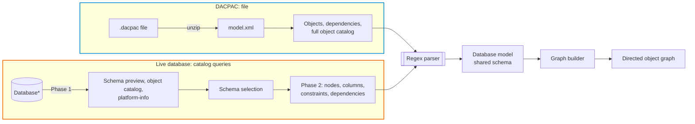
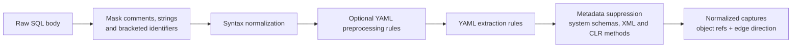
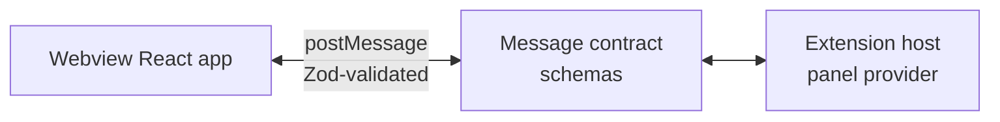

# Developer Guide

How to build and run this extension from a clone. Concepts:
[`ARCHITECTURE.md`](ARCHITECTURE.md). YAML you can edit:
[`PARSE_RULES.md`](PARSE_RULES.md), [`DMV_QUERIES.md`](DMV_QUERIES.md) and
[`AI_PROMPTS.md`](AI_PROMPTS.md). Contributing:
[`../CONTRIBUTING.md`](../CONTRIBUTING.md).

## Toolchain

| Tool | Requirement | Declared in |
|------|-------------|-------------|
| Node.js | `>=20` | `engines.node` in [`package.json`](../package.json) |
| npm | `>=10` | `engines.npm` in [`package.json`](../package.json) |
| VS Code | `^1.101.0` | `engines.vscode` in [`package.json`](../package.json) |

Install with `npm ci` after cloning and after any pull that changes
`package.json` or `package-lock.json`. Use `npm ci` to replace a stale or copied
`node_modules` tree.

LangChain's transitive `langsmith` dependency is replaced by an inert local stub
through npm `overrides`. If the bundle fails with `Could not resolve "langsmith"`,
run `node scripts/repair-langsmith-stub.mjs`; `postinstall` runs it as well.

## Build and run

```bash
git clone https://github.com/ChrisDevRepo/vscode_data_lineage.git
cd vscode_data_lineage
npm ci
```

Press <kbd>F5</kbd> to build the extension host and webview bundles and launch
the Extension Development Host. **Run Extension (Watch)** builds the webview
once, then watches the extension bundle; run `npm run build:webview` after
React or CSS changes.

```bash
npm run typecheck             # type-check only
npm run build                 # esbuild extension + Vite webview
npm test                      # unit tests
npm run gate                  # repository checks, unit tests, builds, package checks
npm run package               # VSIX with the local @vscode/vsce
```

Packaging uses `--no-dependencies` because every production dependency is
bundled before packaging.

## Two ingestion paths, one model



*The live lane supports SQL Server, Azure SQL, Fabric Data Warehouse, and
Synapse Dedicated SQL Pool. Query availability per platform:
[`DMV_QUERIES.md`](DMV_QUERIES.md).

Both paths produce the same database model. The parser does not know the
source: both use the same preprocessing, YAML extraction rules, normalization,
and edge-direction logic. The model records its source (`dacpac` or
`database`).

- **DACPAC.** Reads `model.xml` from the ZIP archive, derives the platform
  label from its DSP, and keeps the lightweight catalog of all objects.
- **Live database.** Runs the queries in
  [`assets/dmvQueries.yaml`](../assets/dmvQueries.yaml) (see
  [`DMV_QUERIES.md`](DMV_QUERIES.md)).
- **Connections.** See [`SECURITY.md`](../SECURITY.md#connections).

## SQL parsing pipeline



Extraction regexes are in
[`assets/defaultParseRules.yaml`](../assets/defaultParseRules.yaml). The full
reference is [`PARSE_RULES.md`](PARSE_RULES.md). Run `npm run test:parser`
after a change.

## Host/webview boundary



Messages crossing the host/webview boundary are parsed with Zod schemas before
a handler uses them. Webview errors are sent to the host as an `error` message
and logged there.
