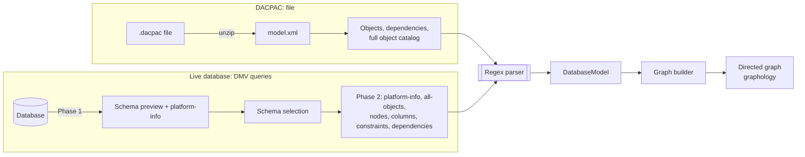

# Developer Guide

How to build, run and change this extension in a clone. Concepts: [`ARCHITECTURE.md`](ARCHITECTURE.md). User-replaceable YAML: [`PARSE_RULES.md`](PARSE_RULES.md), [`DMV_QUERIES.md`](DMV_QUERIES.md), [`AI_PROMPTS.md`](AI_PROMPTS.md). How to propose a change: [`../CONTRIBUTING.md`](../CONTRIBUTING.md).

## Toolchain

| Tool | Requirement | Declared in |
|---|---|---|
| Node.js | `>=20` | `engines.node` in [`package.json`](../package.json) |
| npm | `>=10` | `engines.npm` |
| VS Code | `^1.101.0` | `engines.vscode` |

Run `npm ci` after cloning, after any pull that changes `package.json` or `package-lock.json`, and to replace a stale or copied `node_modules`.

LangChain's transitive `langsmith` dependency is replaced by an inert local stub through npm `overrides`, so the extension never contacts LangSmith. The `postinstall` script [`scripts/repair-langsmith-stub.mjs`](../scripts/repair-langsmith-stub.mjs) copies the stub into place; run it by hand if `node_modules` was copied or the bundle fails with `Could not resolve "langsmith"`.

## Repository layout

The code map with the owner of each layer is in [`ARCHITECTURE.md`](ARCHITECTURE.md#code-map).

## Build and run

```bash
git clone https://github.com/ChrisDevRepo/vscode_data_lineage.git
cd vscode_data_lineage
npm ci
npm run typecheck             # type-check only
npm run build                 # esbuild extension + Vite webview
npm run gate                  # every deterministic check
npm run package               # VSIX with the pinned local @vscode/vsce
```

`npm run lint` and `npm run knip` are report-only and outside the gate.

Press <kbd>F5</kbd> (**Run Extension**) to build both bundles and launch the Extension Development Host. **Run Extension (Watch)** builds the webview once, then watches the extension bundle; run `npm run build:webview` after React or CSS changes.

### Packaging

- `npm run package` writes `data-lineage-viz-<version>.vsix` to the repository root without publishing it. Install it with **Extensions → … → Install from VSIX…** or `code --install-extension ./data-lineage-viz-<version>.vsix`, in a separate VS Code profile first.
- `@vscode/vsce` is an exact-version development dependency. Packaging uses `--no-dependencies`: every production dependency is bundled into `out/` and `dist/`, and `vsce`'s `npm ls` pass misreports npm `overrides` as invalid. Pass it to a direct `vsce package` or `vsce publish` too.
- [`THIRD_PARTY_NOTICES.md`](../THIRD_PARTY_NOTICES.md) must match the bundles; the gate checks it. After a dependency change run `npm run build`, then `node scripts/generate-third-party-notices.mjs`.
- `vsce` never reads `.gitignore`. Excluding a file from the VSIX needs an entry in [`.gitignore`](../.gitignore), [`.vscodeignore`](../.vscodeignore) and the forbidden list in [`tests/tools/assert-package-contents.mjs`](../tests/tools/assert-package-contents.mjs).

## Ingestion: two paths, one model



Both paths produce a `DatabaseModel` through the same preprocessing, parse rules, normalization and edge-direction logic; the parser does not know the source. Each extractor stamps `DatabaseModel.source` (`'dacpac'` or `'database'`).

- **DACPAC:** [`dacpacExtractor.ts`](../src/engine/dacpacExtractor.ts) reads `model.xml` from the ZIP, derives the platform label from its DSP and keeps the lightweight object catalog.
- **Live database:** [`dmvExtractor.ts`](../src/engine/dmvExtractor.ts) and [`connectionManager.ts`](../src/engine/connectionManager.ts) run the queries in [`assets/dmvQueries.yaml`](../assets/dmvQueries.yaml) ([`DMV_QUERIES.md`](DMV_QUERIES.md#query-execution)). Platform detection finishes before the model is built: `platform-info`, or an explicit `Unknown database platform`. A change to SQL sent to a live database updates `DMV_QUERIES.md` (or `PROFILING_PATTERNS.md`) in the same change.
- **Connections:** [`src/engine/db/`](../src/engine/db/). `connectDatabase` returns a `DbSession` from the built-in `tedious` provider with `ReadOnly` application intent; saved connections live in `dataLineageViz.database.connections` and passwords in `SecretStorage`. Connection failures are presented only by `connectionErrors.ts`.
- **Persistence:** [`projectStore.ts`](../src/engine/projectStore.ts). On read, unknown fields are dropped and a project is discarded only when a required field is missing or mistyped. A change to `Project` or `FilterProfile` needs a migration in `migrateProjectStore()`. `StoredConnectionInfoSchema` stays `.strict()` so credentials never enter the store.
- **AI run records:** [`src/ai/session/runStore.ts`](../src/ai/session/runStore.ts) keeps one record per AI-authored bookmark in `globalState` under `dataLineageViz.aiRun.<bookmarkId>`; deleting the bookmark or project clears it, and a record of another `schemaVersion` reads as absent.

## SQL parsing

Extraction regexes are in [`assets/defaultParseRules.yaml`](../assets/defaultParseRules.yaml). [`src/engine/sqlBodyParser.ts`](../src/engine/sqlBodyParser.ts) owns the built-in cleansing passes, rule execution and dependency resolution; the pipeline and its limits are in [`PARSE_RULES.md`](PARSE_RULES.md#how-sql-is-read). Run `npm run test:parser` after a change.

## Boundaries, testing and diagnostics

Host/webview messages are Zod-validated in [`src/engine/shared/bridgeContract.ts`](../src/engine/shared/bridgeContract.ts) before a handler sees them; layer rules are in [`AGENTS.md`](../AGENTS.md#rules) and [`ARCHITECTURE.md`](ARCHITECTURE.md#design-boundaries). `@lineage` reads the loaded model only ([architecture](ARCHITECTURE.md#optional-ai-lineage)); after changing the tool catalog, run `npm run generate:tool-manifest`. Test tiers and machine needs: [`testing/README.md`](testing/README.md), [`testing/ENVIRONMENTS.md`](testing/ENVIRONMENTS.md); run `npm run gate` before a push. Trace and state dumps are described in [`SECURITY.md`](../SECURITY.md#local-files).
